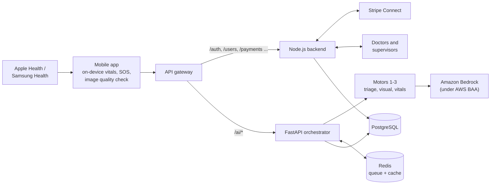
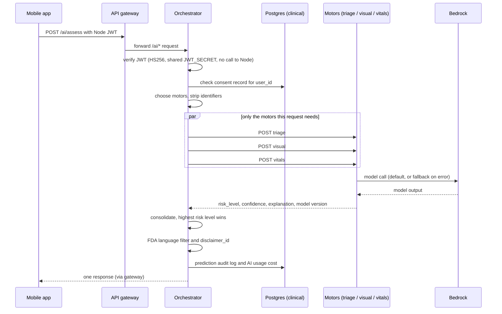
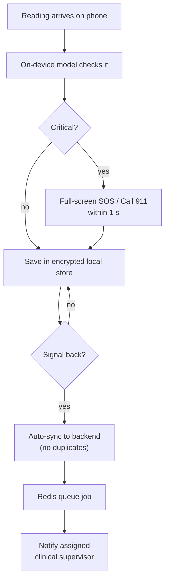
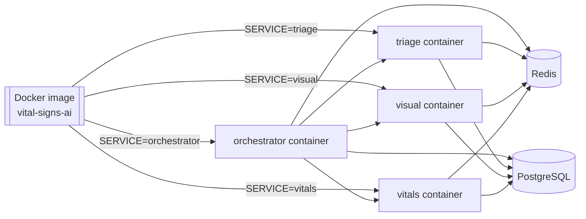
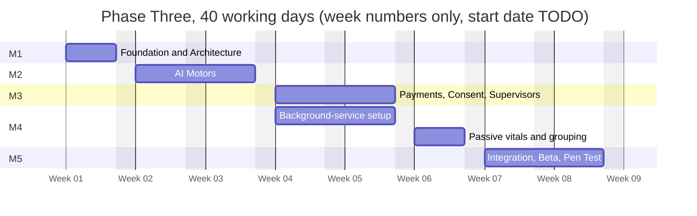

# Vital Signs Phase Three

The complete guide to the Vital Signs Phase Three project: what the system does, who uses it, how it is built and what it must meet.

> **Folder layout and versions:** see [VERSIONS.md](VERSIONS.md). The code is in `backend/`. `gateway/` and `postgres/` are the shared platform that every version (v1, v2, …) uses. Some file paths in the rest of this README come from the older single-folder layout (e.g. `app/` is now `backend/app/`).

This repository holds the **Python FastAPI AI service**, which is the orchestrator plus the three AI motors. The README covers the **whole project**, including the parts built in the mobile app and the existing Node.js backend.

- **Client:** Vital Signs LLC
- **Provider:** Glowinsoft Technologies

> **Source documents**
> - [`docs/Vital-Signs-Phase-3-Project-Proposal-Updated.docx`](docs/Vital-Signs-Phase-3-Project-Proposal-Updated.docx). This is the **signed contract** and the source of truth for scope, schedule and acceptance.
> - [`docs/Phase Three – Developer Requirements Spec.docx`](docs/Phase%20Three%20–%20Developer%20Requirements%20Spec.docx). This holds the detailed technical requirements.
>
> When the two disagree, **the proposal wins**. Every difference is listed in [Differences between proposal and spec](#16-differences-between-proposal-and-spec).
>
> **About `§` numbers:** a reference like "(§17)" is the section number in the client's Phase Three spec v3.3. The proposal cites those sections, and this README keeps them.

---

## Table of contents

1. [Project overview](#1-project-overview)
2. [Who uses the system](#2-who-uses-the-system)
3. [Glossary](#3-glossary)
4. [What the system does](#4-what-the-system-does)
5. [System architecture](#5-system-architecture)
6. [The three AI motors](#6-the-three-ai-motors)
7. [Data contract](#7-data-contract)
8. [Data the system collects](#8-data-the-system-collects)
9. [Security and compliance rules](#9-security-and-compliance-rules)
10. [AI cost target](#10-ai-cost-target)
11. [Acceptance metrics](#11-acceptance-metrics)
12. [Delivery plan](#12-delivery-plan)
13. [Client inputs and deadlines](#13-client-inputs-and-deadlines)
14. [Repository structure and getting started](#14-repository-structure-and-getting-started)
15. [Environment variables](#15-environment-variables)
16. [Differences between proposal and spec](#16-differences-between-proposal-and-spec)
17. [Open questions and risks](#17-open-questions-and-risks)

---

## 1. Project overview

Vital Signs is a health app for general wellness monitoring and early warning. It is **not** a diagnostic device. Phase Three turns it into a monitored-care platform:

- **Three AI motors** check a user's symptoms (chat or voice), photos of wounds or lesions (in-app camera) and vital signs (heart rate, blood pressure, respiratory rate, SpO2).
- **One orchestrator** merges the motors' results into one risk level with safe, FDA-compliant wording, and always sends the user to a healthcare professional.
- **Doctors** confirm or correct every AI result. **Clinical supervisors** oversee doctors and labels, and take emergency calls.
- **Patients** pay doctors through Stripe Connect, give explicit consent, and control their own data.
- **Every reading is labeled**, building a dataset for a future Phase Four predictive model. Phase Three does **not** build that model.

| | |
|---|---|
| **Price** | USD 5,000 fixed. Each milestone is paid after Vital Signs LLC's written acceptance. |
| **Duration** | 8 weeks = 40 working days (Monday to Friday), in 5 milestones |
| **Markets** | United States (HIPAA) and Mexico |
| **AI cost target** | At most USD 0.50 AI processing cost per active user per month |

---

## 2. Who uses the system

| User | What they do |
|---|---|
| **Patient** | Chats about symptoms, scans wounds, has vitals monitored around the clock, receives critical alerts, pays for visits and subscriptions, and manages consent and their own data. |
| **Doctor** | Works a queue of patients sorted by urgency. Confirms or corrects AI results, refers patients to specialists, and contacts their supervisor. Receives payment through their own Stripe Connect account. |
| **Clinical supervisor** | A licensed doctor: one per U.S. state, plus one national supervisor for Mexico. Final authority on labels for their region. Answers doctors' calls and emergency calls, and is notified of critical alerts. Signs an in-app contract. |
| **Labeler** | A credentialed health worker (for example in Mexico or Colombia) who labels readings under a supervisor. Accepts the labeling manual in-app. |
| **Admin** | Sets prices by country, state and doctor level, and edits refund rules. |
| **Development team** | Builds and runs the system, with restricted access to health data. |

---

## 3. Glossary

| Term | Meaning in this project |
|---|---|
| **Motor** | One AI service behind the orchestrator: Triage (Motor 1, conversational), Visual (Motor 2) or Vitals (Motor 3). |
| **Orchestrator** | The service that receives an AI request from the app. It calls the right motors in parallel, merges their results, applies the FDA wording rules and the disclaimer, logs the AI cost and returns one response. |
| **Consolidation** | The step where the orchestrator merges motor outputs. The **highest risk level wins**. |
| **FDA language filter** | A post-processor that checks all user-facing text for banned and required phrases, then blocks or rewrites violations. |
| **Disclaimer ID** | The version ID of the disclaimer shown with a result. It is stored with every prediction. |
| **PHI** | Protected Health Information: any health data linked to a person, such as vitals, symptoms, photos or voice. |
| **BAA** | Business Associate Agreement. The legal agreement that lets AWS process PHI, signed in AWS Artifact. There is only one BAA, with AWS. |
| **Bedrock** | Amazon's managed AI model service. It is the **only** route allowed for AI calls. |
| **HIPAA-eligible model** | A Bedrock model that AWS lists as covered by the BAA. Being on Bedrock does not make a model eligible. |
| **Allow-list** | The list of models that may receive PHI (see [§9](#9-security-and-compliance-rules)). |
| **Zero data retention** | The AI endpoint does not store prompts or outputs. |
| **Label** | The tag stored on every vitals reading: *confirmed diagnosis*, *reported symptom* or *normal reading*. |
| **Label source** | Who or what set a label: user, labeler, supervisor or doctor. |
| **Risk level** | The output of a motor: `low`, `medium`, `high` or `critical`. |
| **Confidence score** | The motor's confidence in its risk level, from 0.0 to 1.0. |
| **Medical source** | The finding type, evidence level and a traceable reference attached to a suggestion. |
| **Escalation** | Routing a request to a stronger, more expensive model (for example from Haiku to Sonnet) because of red flags, low confidence or conflicting answers. |
| **Fallback / failover** | Switching to a backup model when the default model times out or fails. |
| **Critical alert (SOS)** | A full-screen alert with SOS and Call 911 buttons, which can only be closed by a deliberate gesture. |
| **Active user** | A distinct user with at least one app session in the month. This is the divisor for the cost target. |
| **Pseudonymous `user_id`** | The only link between the Node and Python data. It never contains a name, email or phone number. |
| **Stripe Connect (direct charges)** | Payment setup in which the doctor's share is charged straight to the doctor's own Stripe account and the platform takes only an application fee. |
| **Phase Four** | A future predictive-model project. It is not in this contract. Phase Three only collects data for it. |

---

## 4. What the system does

Each feature area lists where it is built:

- **App:** iOS and Android.
- **Node:** the existing Node.js backend.
- **AI:** this Python repository.

| # | Feature area | App | Node | AI (this repo) |
|---|---|:---:|:---:|:---:|
| 4.1 | Symptom triage (Motor 1) | ✅ | | ✅ |
| 4.2 | Visual scan and in-app camera (Motor 2) | ✅ | | ✅ |
| 4.3 | Vital signs and offline mode (Motor 3) | ✅ | | ✅ |
| 4.4 | Critical alert (SOS) | ✅ | | |
| 4.5 | Safe wording, disclaimers and audit log | | | ✅ |
| 4.6 | Payments and doctor ranking | ✅ | ✅ | |
| 4.7 | Consent and user rights | ✅ | ✅ | ✅ (consent records) |
| 4.8 | Supervisor communication | ✅ | ✅ | |
| 4.9 | Doctor tools | ✅ | TODO | ✅ (corrections as labels) |
| 4.10 | Data labeling workflow | ✅ | TODO | ✅ (clinical data) |
| 4.11 | Passive vitals pipeline | ✅ | | ✅ (storage) |
| 4.12 | Demographic grouping | | | ✅ |
| 4.13 | Platform, scaling and testing | | ✅ | ✅ |

TODO: confirm which backend owns the doctor queue and the labeling workflow APIs (see [Open questions](#17-open-questions-and-risks)).

### 4.1 Symptom triage (Motor 1)
- The user describes symptoms in a chat, by text or voice.
- The AI returns a risk level with a short explanation and always recommends a healthcare professional.
- The result is stored as a **pre-assessment**. A doctor confirms or corrects it, and a correction becomes labeled data.
- Audio of every voice triage call is recorded, after explicit recording consent. This is capture and labeling only, with no voice-analysis model. (§2, §4)

### 4.2 Visual scan and in-app camera (Motor 2)
- **Entry point:** a floating red pulse button opens a full-screen camera inside the app. It uses AVFoundation on iOS and CameraX on Android; no external camera app is used.
- **Before any image is processed:** the user grants camera permission with clear purpose text, then gives explicit consent.
- **Taking the photo:** a guide frame shows "center the wound here", with live quality hints such as "move closer, there is shadow".
- **Stage 1, on-device:** a quality check decides in **under 1 s** and rejects unusable photos.
- **Stage 2, Bedrock:** a cloud vision model returns a structured description. It never returns a diagnosis.
- **Scan history:** every scan is saved like a medical record, with date, result and recommendation. A doctor confirms the final verdict. (§2)

### 4.3 Vital signs and offline mode (Motor 3)
- An **on-device** model watches heart rate, blood pressure, respiratory rate and SpO2. It raises early warnings and never diagnoses.
- Critical alerts fire **within 1 s** and work **with no internet**.
- **Offline:** readings and alerts are saved in an encrypted local store. They sync automatically when the signal returns, without duplicates, and the assigned supervisor is notified of any critical alert raised offline.
- The cloud motor only writes a plain-language **explanation** of a reading. (§2)

### 4.4 Critical alert (SOS)
When any motor returns `critical`:
- A full-screen red view blocks the whole app: no navigation, tabs or back gesture.
- It shows two actions: **SOS** and **Call 911**.
- It closes only with a deliberate gesture, such as press-and-hold or slide-to-dismiss, never a single tap.
- It works offline.
- Every alert is logged with time, trigger, what the user did and time to dismiss. The assigned supervisor is notified. (§15)

### 4.5 Safe wording, disclaimers and audit log
- Every AI result passes the **FDA language filter** in the orchestrator before the user sees it. See the do / don't table in [§9](#9-security-and-compliance-rules).
- Every result shows the mandatory disclaimer: "This result is not a diagnosis. Always consult your doctor." The disclaimer is versioned.
- Every result carries a **traceable medical source**: finding type, evidence level and a citable reference taken from a curated library, never invented by the model.
- The **prediction audit log** records date, input, disclaimer shown and the user's response for every prediction. (§12)

### 4.6 Payments and doctor ranking (§17)
- **Subscriptions:** monthly and annual 24/7 monitoring plans, with automatic reminders for unpaid users.
- **Pay before booking:** no payment, no appointment. Options are a single visit, 3- or 5-visit packs, or a monthly visit plan. Invoices and receipts are automatic.
- **Stripe Connect direct charges:**
  - The doctor's share goes straight to the doctor's verified connected account.
  - The platform takes only its agreed application fee.
  - The platform never receives, retains, pools or holds the doctor's funds.
- **Automatic refunds** when the doctor cancels or a technical error stops the paid service:
  - Refunds are started by webhooks, with signature checks, duplicate protection, retries, reconciliation and an audit trail.
  - The amount goes back to the original payment method. For packs, only the affected visit is refunded.
  - The 12-hour patient cancellation rule does not limit these refunds.
- **Admin pricing** by country, state and doctor level: a three-level structure for Mexico and a specialist table for the U.S. The price is chosen from the patient's location.
- **Doctor ranking:** patients see only a label (New, Experienced or Senior doctor), never raw years of practice.

### 4.7 Consent and user rights (§4, §14)
- **Consent checkboxes**, unchecked by default:
  - 24/7 monitoring with the FDA disclosure is **required**.
  - Research participation (data labeling) is **optional** and can be withdrawn at any time.
- **Consent records:** each consent is logged with timestamp, IP, app version and disclaimer version. Mexico users see a data-transfer notice.
- **No monitoring without consent.** 100% of monitored users must have a stored consent record.
- **User rights:**
  - Export of the user's data.
  - Transfer of data to their doctor.
  - Deletion with a 7-day grace period.
  - COPPA age checks.
  - Re-consent when moving between the U.S. and Mexico.

### 4.8 Supervisor communication (§10, §11)
- **Assignment:** each doctor's profile is set to one supervisor per U.S. state, or the national supervisor for Mexico.
- **Contact Supervisor:** a button on every case screen offers voice, video, chat with attachments, and a red **Emergency Call**.
- **Emergency Call:** rings the supervisor's phone and shows a full-screen flashing alert that is dismissed only deliberately.
- **Supervisor Communication panel:** opens the linked case. Every contact is logged with participants and response time.

### 4.9 Doctor tools (§9, §10)
- **Patient queue** sorted by urgency (Normal, Warning, Urgent), with a full summary in one tap.
- **Refer-to-specialist:** one button sends the full package, meaning symptoms, vitals and any wound photo.
- **Trend graphs** for heart rate, blood pressure and SpO2 over 7 and 30 days.
- **Corrections as labels:** doctor confirmations and corrections are saved to the audit trail as labeled data.
- **Cross-border rule:** a Mexican doctor's prescription for a U.S. patient goes through the licensed U.S. prescriber.

### 4.10 Data labeling workflow (§4, §6)
- Labelers label readings. Supervisors review an **audited sample** and are the final authority for their region.
- Supervisors sign an **in-app contract** with e-signature, stored with timestamp, IP and contract version.
- At the start of the project, the provider estimates the effort to **label existing data retroactively**.

### 4.11 Passive vitals pipeline (§4, §5)
- **Android:** a foreground service with a persistent notification, plus a first-use prompt to exclude the app from battery optimization.
- **iOS:** HealthKit background delivery, Background App Refresh and silent push, with clean re-engagement after a force-quit.
- **Capture and labeling only, with no predictive model:**
  - Voice biomarkers.
  - Accelerometer data and screen-use patterns.
  - HRV and sleep.
  - Steps, distance, active calories, blood oxygen, body temperature, blood pressure, glucose, ECG, physical activity level, stress, body composition and respiratory rate, from Apple Health and Samsung Health.
- **Tested** for 72 hours on Vital Signs LLC devices: at least 95% uptime on Android, plus a readings report on iOS.

### 4.12 Demographic grouping (§7)
- Readings are grouped by ethnicity and age.
- The grouping is validated on a **synthetic dataset** that remains the exclusive property of Vital Signs LLC, whoever generates it.
- The dataset is delivered with its schema, labels, generation method, provenance and validation results per group.

### 4.13 Platform, scaling and testing (§3, §18, §19)
- **Scaling:** Kubernetes auto-scaling, caching of non-personal responses, and Prometheus and Grafana alerts.
- **Load:** a load test at 10,000 concurrent users.
- **Security:** an external penetration test, all findings fixed, and a vendor retest with no critical issue open.
- **Beta:** a complete technical beta on iPhone and Android.

---

## 5. System architecture

### 5.1 The whole system



**The components:**

- **Mobile app** (iOS and Android). It runs the time-critical parts on the device: vitals readings, critical alerts and the Stage 1 image check. It also reads Apple Health and Samsung Health data.
- **API gateway.** The app's single URL. `/auth`, `/users`, `/payments` and the other existing routes go to Node. `/ai/*` goes to the FastAPI orchestrator. **The motors cannot be reached from outside.**
- **Node.js backend** (existing). It handles login and authentication, users, Stripe payments, consent UI flows and supervisor communication. It issues **access tokens (JWT) signed with HS256** and a shared secret, `JWT_SECRET`.
- **FastAPI orchestrator** (this repo). It verifies the Node JWT locally with the same `JWT_SECRET` (`python_auth/`) and **never calls Node per request**. Because the secret is shared, anyone who has it can also create valid tokens, so it must be kept as safe as on the Node side.
- **Three FastAPI motor services** (this repo): `triage`, `visual` and `vitals`.
- **Redis.** A message queue and cache shared by all services.
- **PostgreSQL.** Node keeps its own tables. Python owns a separate `clinical` schema that **only Alembic** manages.
- **Amazon Bedrock.** The only way to reach AI models, under the AWS BAA.

**How requests travel:**

- **Synchronous** work, such as triage, uses direct REST calls from the orchestrator to each motor.
- **Asynchronous** jobs go through the Redis queue. These jobs are image escalation, offline vitals sync and supervisor notifications.

### 5.2 One AI request (`POST /ai/assess`)



When Motor 2 flags an image for a Sonnet review, that review runs as a **queued job**, and its result arrives later. TODO: decide how the app receives it.

### 5.3 Offline vitals behaviour



### 5.4 Deployment: one image, four containers

All four AI services share **one codebase and one Docker image**. The `SERVICE` environment variable chooses which part loads: `orchestrator`, `triage`, `visual`, `vitals`, or `all`.

- **Local development:** `SERVICE=all` runs everything in one process.
- **Deployment:** the same image runs as **four separate containers** that scale independently. This meets the spec's rule that each motor is its own service.



### 5.5 Who owns what

| Area | Node.js backend (existing) | FastAPI AI service (this repo) |
|---|---|---|
| Login, auth, JWT issuing (HS256) | ✅ owns | Verifies only, with the shared `JWT_SECRET` |
| Users and profiles (names, emails, phones) | ✅ owns | ❌ never stored |
| Stripe payments, subscriptions, refunds | ✅ owns | — |
| Consent UI flows | ✅ owns | Stores and checks **consent records** in `clinical` |
| Supervisor communication | ✅ owns | Puts notification jobs on the queue |
| AI orchestration, motors, Bedrock calls | — | ✅ owns |
| FDA wording filter and disclaimers | — | ✅ owns |
| Readings, labels, predictions, audit logs, access log, AI usage and cost | — | ✅ owns (`clinical` schema, Alembic only) |

The two sides are linked **only** by the pseudonymous `user_id`.

---

## 6. The three AI motors

Models and routing come from *Proposal › AI model routing and cost*. Every route must pass the same quality, latency and privacy checks. **Clinical escalation must never be blocked to meet a cost quota.**

| | Motor 1: Triage | Motor 2: Visual | Motor 3: Vitals |
|---|---|---|---|
| **Purpose** | Symptom conversation, then a risk level | Wound and lesion photo analysis | Explain on-device readings |
| **Runs on-device** | — | Stage 1 quality check (under 1 s) | Readings and critical alerts |
| **Default model** | Claude Haiku 5.5 | Claude Haiku 5.5 | Claude Haiku 5.5 (500 in / 200 out tokens) |
| **Escalation** | Claude Sonnet 5.5 for red flags, low confidence or conflicts (20% assumed) | Claude Sonnet 5.5 reviews flagged images (20% assumed) | — |
| **Fallback** | Nova Pro, then Llama 3.3 70B (text only) | Nova Pro (Llama is **not** used for images) | Nova Lite |
| **Latency** | Under 3 s end to end (p95) | Stage 1 under 1 s; TODO: no Stage 2 target | Alert within 1 s, on-device |
| **Quality** | ≥ 85% agreement with doctor labels | Doctor confirms every result | < 5% false critical alerts; ≥ 80% sensitivity (M2 gate) |
| **Must also** | Validate the JSON output and retry if it is invalid; store the model name and version | Get consent first; return a structured description | Work offline |
| **Must never** | Diagnose, name a medical action, state certainty, or send identifiers | Diagnose, or send images to a model that is not HIPAA-eligible | Diagnose, or decide the risk level in the cloud |

---

## 7. Data contract

The base contract comes from the developer spec. Fields marked *proposed* and the example `data` payloads are a proposed shape, not contract requirements.

### 7.1 Common motor input

```json
{
  "user_id": "pseudonymous-id",
  "timestamp": "2026-01-01T12:00:00Z",
  "input_type": "text | image | vitals | audio",
  "data": {}
}
```

### 7.2 Common motor output

```json
{
  "risk_level": "low | medium | high | critical",
  "confidence_score": 0.0,
  "explanation": "string",
  "disclaimer_id": "id of the disclaimer version shown",
  "finding_type": "optional string",
  "evidence_level": "optional string",
  "reference": "optional traceable, citable source"
}
```

Proposed internal fields, which are stored but not shown to the user: `model_id`, `model_version`, `route` (default, escalation or fallback), `input_tokens`, `output_tokens` and `latency_ms`.

### 7.3 Per-motor `data` (proposed)

| Motor | `input_type` | Example `data` |
|---|---|---|
| Triage | `text` or `audio` | `{"session_id": "…", "message": "I feel dizzy since morning", "history": [ … ]}` |
| Visual | `image` | `{"scan_id": "…", "image_ref": "…", "stage1": {"quality": "ok", "confidence": 0.62, "risk_hint": "high"}}` |
| Vitals | `vitals` | `{"heart_rate": 72, "bp_systolic": 120, "bp_diastolic": 80, "respiratory_rate": 16, "spo2": 98, "device_risk_level": "medium"}` |

### 7.4 Orchestrator response to the app

```json
{
  "risk_level": "high",
  "confidence_score": 0.81,
  "explanation": "Your answers suggest this is worth reviewing with a healthcare professional.",
  "disclaimer_id": "disc-v1",
  "disclaimer_text": "This result is not a diagnosis. Always consult your doctor.",
  "finding_type": "…",
  "evidence_level": "…",
  "reference": "…",
  "motors": ["triage", "vitals"]
}
```

`risk_level` is the highest risk level among the motors that were called. TODO: define how the other fields are merged when several motors respond.

---

## 8. Data the system collects

### Readings and labels
Every vitals reading is stored with one of three mandatory labels:

| Label | When it applies |
|---|---|
| Confirmed diagnosis | A network doctor later confirms a real result. This is the highest-value label. |
| Reported symptom | The user reported feeling something at the time of the reading. |
| Normal reading | No symptom or event. The model needs these to learn what normal looks like. |

Each record also stores `timestamp` (UTC), pseudonymous `user_id`, vitals, `label`, `label_source`, `model_version`, `state`, `country` and device metadata. (§4, §14)

### Tables in the `clinical` schema (Python, Alembic only)
- Readings and labels
- Predictions
- Prediction audit log
- Clinical audit trail, including doctor corrections
- Access log
- Consent records
- AI usage and cost
- Capture streams (voice and passive data)

TODO: finalise the table list in the schema documentation.

**Clinical tables never store names, emails or phone numbers.**

---

## 9. Security and compliance rules

### PHI rules
- **No real patient data** touches any server until the AWS BAA is signed and active.
- AI models are called **only through Amazon Bedrock**, under the single AWS BAA. There is no direct BAA with any model vendor.
- AI calls carry **only vitals and symptoms**: never a name, phone, email, address or other identifier.
- **Zero data retention** applies on all AI endpoints.
- Cache only **non-personal** responses. PHI is never cached outside the encrypted store.

### Model allow-list

| Model | PHI allowed? |
|---|---|
| Claude Sonnet, Haiku, Opus (HIPAA-eligible versions) | Yes |
| Amazon Nova (Pro, Lite, Act), Amazon Titan | Yes |
| Meta Llama, Mistral, Cohere | Yes |
| Claude Fable, Claude Mythos | **No** |
| Grok 4.3 / 4.6 | **No.** Non-PHI work only, until AWS lists it as HIPAA-eligible. |

Before any model goes live, check it against AWS's **current** HIPAA-eligible list.

### Encryption, access control and logging
- **At rest:** AES-256, covering the database, backups and the phone's local store.
- **In transit:** TLS 1.3.
- **RBAC roles:** the NestJS access token carries the role as the numeric `user_type` claim, and `python_auth/roles.py` mirrors the NestJS `UserType` enum exactly:

  | `user_type` | Role | `audit_log.actor_role` |
  |---|---|---|
  | 0 | Admin | `admin` |
  | 1 | User (patient) | `patient` |
  | 2 | Doctor | `doctor` |
  | 3 | Guest | none: a guest never writes health data |
  | 4 | Supervisor (clinical supervisor) | `supervisor` |
  | 5 | Labeler | `labeler` |
  | 6 | Developer (restricted) | `developer` |

  The user id is the `_id` claim. Endpoints opt in with `require_roles(...)`; `POST /ai/assess` is patient-only. The mapping to `actor_role` is `actor_role_for()` in `app/shared/jobs.py`.
- **Access log:** every health-data access is logged with **who, when and why**. The reason field is required.

### FDA wording rules

| Rule | Do | Don't |
|---|---|---|
| No certainty | "indicates", "suggests", "worth reviewing" | "you have", "this is" |
| No specific medical action | "contact a healthcare professional" | "go to the ER", "take this medicine" |
| Always redirect | Point every result to a doctor | End a result without a referral |
| Fixed disclaimer | "This result is not a diagnosis. Always consult your doctor." | Omit or shorten it |
| Traceable source | A citable reference from the curated library | "per literature", or citations the model invented |

### Consent
- Monitoring consent is required; research consent is optional and revocable. Both checkboxes are unchecked by default.
- Consent is also required before any image is processed and before triage audio is recorded.
- 100% of monitored users must have a stored consent record.

---

## 10. AI cost target

**Target:** AI processing cost of **no more than USD 0.50 per active user per month**. The proposal's planning model estimates about USD 0.197. That figure is a modeled estimate, not a measured result.

**Routing:**
- Each motor uses the cheapest suitable default (Haiku 5.5).
- Escalation to Sonnet 5.5 happens only when it is needed.
- Fallbacks are Nova Pro, Llama 3.3 70B or Nova Lite.
- Image quality checks and vitals inference run on-device, so neither has a cloud charge.

**Cost controls:**
- Bounded prompts and outputs, and compact context.
- Caching where it is permitted.
- Capped retries.
- Metering by **user, model and motor**.
- A Grafana alert when the projected cost reaches **USD 0.40** per active user.
- Critical alerts, clinical escalation and quality thresholds are **never** cut to save cost.

**How it is measured:**
- **Included:** all billable AI charges (tokens, retries, failovers, and any paid guardrail, embedding, retrieval or speech service).
- **Not included:** hosting and Stripe fees.
- **The divisor:** distinct users with at least one app session in the month.
- **Usage profile:** agreed with the client at the start of the project, benchmarked in M2 and revalidated on the beta in M5.

---

## 11. Acceptance metrics

| Metric | Target |
|---|---|
| Triage accuracy against doctor labels | ≥ 85% |
| False critical alerts | < 5% |
| Triage latency | < 3 s (p95) |
| Vitals alert latency | < 1 s |
| Visual Stage 1 decision | < 1 s |
| Availability | 99.5% uptime |
| Consent coverage before monitoring | 100% |
| Vitals model sensitivity | ≥ 80% against labeled cases (M2 release gate) |
| Load | 10,000 concurrent users |
| Penetration test | No critical vulnerability open after the retest |
| Android background uptime (72 h test) | ≥ 95% |
| AI cost | ≤ USD 0.50 per active user per month |

---

## 12. Delivery plan

The work is delivered in 5 milestones over 40 working days. Each milestone is submitted at the end of its last week and paid after written acceptance. Reviews run while the next milestone is built.

| Milestone | Weeks | Working days | Covers (see [§4](#4-what-the-system-does)) | Acceptance evidence |
|---|---|---|---|---|
| M1 · Foundation and Architecture | 1 | 1–5 | Gateway, orchestrator, Redis queue, data contract, Alembic schema, security baseline, schema docs, retroactive-labeling estimate, cost metering | Deliverables, schema docs, estimate, confirmed rate sheet |
| M2 · AI Motors | 2–3 | 6–15 | 4.1–4.5 | ≥80% vitals sensitivity, latency tests, model benchmark, cost-per-image report, ≤ USD 0.50 benchmark |
| M3 · Payments, Consent, Supervisor Communication | 4–5 | 16–25 | 4.6–4.8 | Refund and funds-flow tests |
| M4 · Passive Vitals and Demographic Grouping | 6 | 26–30 | 4.11–4.12 | 72-hour test reports, synthetic dataset and validation results |
| M5 · Final Integration and Technical Beta | 7–8 | 31–40 | 4.7 user rights, 4.9, 4.10, 4.13, end-to-end flow | Load test, metrics check, pen-test retest, beta, cost dashboard |



*The chart uses an arbitrary Monday so that the axis shows week numbers. M4's background-service setup overlaps M3 in Week 5.* TODO: contract start date.

---

## 13. Client inputs and deadlines

| Needed by | Input from Vital Signs LLC |
|---|---|
| Week 1 | AWS account with Bedrock access, and agreement on the AI usage profile |
| Before any real patient data is used | BAA signed and active |
| Week 4 | Stripe account access for the Connect setup |
| Start of Week 6 | iPhone and Android test devices, including Samsung and Xiaomi |
| End of Week 7 | Penetration-test vendor booked to start on the beta build |
| Week 8 | Vendor retest scheduled within the week |

---

## 14. Repository structure and getting started

### Where the code lives

| Part | Repository |
|---|---|
| AI service (orchestrator and motors) | **This repo** |
| Node.js backend | TODO: link |
| Mobile apps (iOS and Android) | TODO: link |

### Target layout of this repo (full project; only part of it exists so far)

```text
.
├── main.py                 # FastAPI entry point; reads SERVICE and mounts the matching routers
├── app/
│   ├── shared/             # Config, RBAC, DB session, Redis, Bedrock client, contract schemas, access log
├── python_auth/            # JWT verification: current_user(), require_roles(), UserType
│   ├── orchestrator/       # /ai/* routes, motor selection, parallel calls, consolidation, FDA filter, cost logging
│   └── motors/
│       ├── triage/         # Motor 1: conversational triage
│       ├── visual/         # Motor 2: Stage 2 image analysis
│       └── vitals/         # Motor 3: explanations of on-device readings
├── collection/             # SQLAlchemy models, one file per table (what Alembic compares with the database)
├── alembic/                # Migrations for the "ai" schema (the only way to change it)
├── db/bootstrap.sql        # Creates the logins and the database (the one step Alembic cannot do)
├── old_sql/                # Archive of the old hand-written SQL scripts (not used)
├── tests/                  # Contract, motor and latency tests (proposed)
├── docs/                   # Source documents, schema diagram and guide
├── Dockerfile              # One image for all four services
├── docker-compose.yml      # Local stack: app (SERVICE=all) + Postgres + Redis
└── README.md
```

### Getting started (Milestone 1, step 1: stub service)

**What this step does.** It sets up the skeleton of the AI service. The orchestrator (`POST /ai/assess`) checks which inputs the request contains (symptoms, image, vitals). It calls only the motors it needs, all at the same time, and gives each one 2.5 seconds. It keeps the highest risk level, applies the FDA wording rules and returns one answer. The three motors answer with simple rules (for example, `heart_rate > 120` gives `high`). Each motor already picks its AI model from one central routing configuration (`app/configurations/`) and calls it through one Bedrock function, but this stays off (`USE_BEDROCK=false`) until M2 and the signed BAA, so nothing calls AWS and every cost row is 0. After answering, the orchestrator puts the result on a **Redis queue**, and a separate **worker** saves it to Postgres (see [Queue and worker](#queue-and-worker)). Everything can run on your Mac directly or in Docker (see [Run with Docker](#run-with-docker)). Every request needs a NestJS access token (see below).

**Current files:**

```text
main.py                       reads SERVICE, includes the right routers, GET /health
app/config.py                 every environment variable, read in one place
app/shared/contracts.py       Pydantic models: MotorInput, MotorOutput, AssessRequest, AssessResponse
app/orchestrator/routes.py    POST /ai/assess: pick motors, call them in parallel
app/orchestrator/consolidate.py   combine motor answers (highest risk wins)
app/orchestrator/fda_filter.py    banned phrases + disclaimer
app/motors/<name>/routes.py   POST /motor/<name>/analyze  (triage, visual, vitals)
app/motors/<name>/logic.py    the rules for that motor; calls model.py and copies its result into MotorOutput
app/motors/<name>/model.py    get_model() picks the routed model, run_model() calls it (stub when USE_BEDROCK=false)
app/motors/runner.py          shared by the motors: try the model, then each fallback, within MOTOR_TIMEOUT_SECONDS
app/configurations/models.py  every model: Bedrock ID, price per 1M tokens, image support, version
app/configurations/routing.py default / escalation / fallback models and max output tokens per motor (ROUTING_VERSION)
app/configurations/pricing.py cost_usd(): tokens × price, saved to ai.ai_usage
app/shared/bedrock.py         the one Bedrock caller: converse() with a hard timeout
app/orchestrator/build_job.py turns one /ai/assess call into a SaveAssessmentJob (the rows to save)
app/shared/jobs.py            Pydantic models of the queued jobs; one *Row model per database table
app/shared/queue.py           enqueue(): XADD to a Redis Stream, or write to failed_enqueue.jsonl if Redis is down
app/shared/redis_client.py    the shared Redis connection
app/shared/db.py              the shared Postgres connection (SQLAlchemy async + asyncpg)
app/worker/main.py            the worker loop (python -m app.worker): read jobs, save, ACK, retry, dead-letter
app/worker/handlers.py        one transaction per job
app/worker/repository.py      the INSERT statements, one function per table
Dockerfile                    one image for the API (any SERVICE) and the worker
docker-compose.yml            local stack: api + worker + postgres + redis (+ 4-container "split" profile)
docker/postgres-init.sh       creates the Docker Postgres logins and database with db/bootstrap.sql
collection/                   SQLAlchemy models, one file per table, all loaded by collection/__init__.py
alembic/, alembic.ini         Alembic migrations; alembic/env.py reads DATABASE_URL or the DB_* values
db/bootstrap.sql              logins + database (run as the Postgres admin, before alembic upgrade head)
old_sql/                      the old hand-written SQL scripts, kept for reference only
tests/                        test_assess, test_build_job, test_queue, test_worker (real DB; skipped if it is down)
```

**Install** (Python 3.9+):

```bash
python3 -m venv .venv
source .venv/bin/activate
pip install -r requirements.txt
pip install -r requirements-dev.txt     # only needed to run the tests (adds pytest)
```

**Run** (everything in one process, `SERVICE=all` is the default):

```bash
uvicorn main:app --reload
```

Settings are read from `.env` automatically (`app/config.py` loads it); a variable set in the shell wins over the file. `setup_db.sh` writes the `DB_*` values; the other keys are listed in `.env.example`. To run a single part, start uvicorn with that variable set, for example `SERVICE=vitals uvicorn main:app --port 8003`.

**Open the API docs:** go to http://localhost:8000/docs. You can send test requests from that page.

**Run the tests:**

```bash
pytest
```

**Every `/ai/assess` call needs a patient access token** (`Authorization: Bearer …`), the same JWT the NestJS backend issues at login. The user id is taken from the token (`_id`), never from the body; a `user_id` in the body is ignored. No token or a bad/expired one → 401, a non-patient (e.g. doctor) → 403. For local testing, make a 1-hour patient token signed with the `JWT_SECRET` from your `.env`:

```bash
export TOKEN=$(python -c "import os, time, jwt; from app import config; now = int(time.time()); print(jwt.encode({'_id': '650f1c2e9b1d4a0012345678', 'user_type': 1, 'is_refresh': False, 'iat': now, 'exp': now + 3600}, os.environ['JWT_SECRET'], algorithm='HS256'))")
```

**Example requests:**

```bash
# 1. Vitals only
curl -X POST http://localhost:8000/ai/assess -H "Content-Type: application/json" -H "Authorization: Bearer $TOKEN" \
  -d '{"vitals": {"heart_rate": 130, "spo2": 93, "systolic": 150, "diastolic": 95, "respiratory_rate": 22,
                  "client_reading_id": "r_001"},
       "context": {"country": "US", "state": "CA", "app_version": "1.0.0"}}'

# 2. Symptoms only
curl -X POST http://localhost:8000/ai/assess -H "Content-Type: application/json" -H "Authorization: Bearer $TOKEN" \
  -d '{"symptoms": "headache and dizziness"}'

# 3. All three
curl -X POST http://localhost:8000/ai/assess -H "Content-Type: application/json" -H "Authorization: Bearer $TOKEN" \
  -d '{"symptoms": "headache and dizziness", "image": "img_001",
       "vitals": {"heart_rate": 130, "spo2": 93, "systolic": 150, "diastolic": 95, "respiratory_rate": 22,
                  "client_reading_id": "r_002"},
       "context": {"country": "US", "state": "CA", "app_version": "1.0.0"}}'

# Health check (works on every SERVICE)
curl http://localhost:8000/health
```

When `vitals` are sent, `vitals.client_reading_id` (an id made on the phone) and `context.country` are required, because the database needs them. Sending the same `client_reading_id` again for the same user saves the reading only once.

Example answer (request 3):

```json
{
  "risk_level": "high",
  "confidence_score": 0.6,
  "explanation": "Your symptoms are worth reviewing with a healthcare professional soon. ...",
  "disclaimer_id": "disc_v1",
  "disclaimer": "This result is not a diagnosis. Always consult your doctor.",
  "motors_used": ["triage", "visual", "vitals"],
  "motors_failed": [],
  "prediction_id": "feb33035-0153-4893-adef-12edcc32f867"
}
```

**Request flow:**

```text
 App
  │  POST /ai/assess {user_id, symptoms?, image?, vitals?}
  ▼
 orchestrator/routes.py
  │  build_motor_inputs(): one MotorInput per input that is present
  │  asyncio.gather(): call the motors in parallel over HTTP (httpx), 2.5 s each
  │
  ├──► POST /motor/triage/analyze  ─► triage/logic.py  ─┐
  ├──► POST /motor/visual/analyze  ─► visual/logic.py  ─┤  MotorOutput
  └──► POST /motor/vitals/analyze  ─► vitals/logic.py  ─┘  (or failure/timeout → motors_failed)
  │
  ▼
 orchestrator/consolidate.py   highest risk wins; all failed → "medium" + safe message
  │
  ▼
 orchestrator/fda_filter.py    banned phrase → safe explanation; add disclaimer_id + disclaimer
  │
  ▼
 orchestrator/build_job.py     build the rows; enqueue() → Redis "jobs:save_assessment"  (no waiting for the DB)
  │
  ▼
 App  ◄── {risk_level, confidence_score, explanation, disclaimer_id, disclaimer, motors_used, motors_failed, prediction_id}
```

With `SERVICE=all`, the "HTTP calls to motors" go back into the same server on `localhost:8000`. When the parts run separately later, only `TRIAGE_URL`, `VISUAL_URL` and `VITALS_URL` need to change.

### Queue and worker

The API never writes to Postgres itself. After answering, it puts **one job** on a Redis Stream with everything about that check. A separate **worker** process saves the job in **one transaction**. If that transaction fails, nothing from the job is saved, so a half-saved check can never exist. The API stays fast, and a slow or restarting database does not affect users.

```text
 /ai/assess ──XADD──► Redis "jobs:save_assessment" ──XREADGROUP──► worker ──one transaction──► Postgres (ai schema)
                         (consumer group "db-writers")                │      vitals_readings → assessments →
                                                                      │      motor_results, ai_usage, audit_log
                                                                      └──XACK only after COMMIT
```

| Stream | Contents |
|---|---|
| `jobs:save_assessment` | One job per `/ai/assess` call: reading (if vitals were sent), assessment, one `motor_results` and one `ai_usage` row per motor that answered, and one `audit_log` row |
| `jobs:audit` | Standalone `audit_log` rows, e.g. "a doctor viewed this data" (`enqueue_audit()`, used from later milestones) |
| `jobs:dead` | Jobs that failed `MAX_JOB_ATTEMPTS` times (default 5), with the error |

**1. Start Redis with persistence** (once). Persistence keeps queued jobs when Redis restarts:

```bash
brew install redis
brew services start redis
redis-cli CONFIG SET appendonly yes
redis-cli CONFIG REWRITE
```

Postgres must be running and set up with `bash setup_db.sh` (logins and database, then `alembic upgrade head`).

**2. Run the API and the worker in two terminals** (both from the project folder, with `.venv` active):

```bash
# Terminal 1
uvicorn main:app --reload

# Terminal 2
python -m app.worker
```

`curl http://localhost:8000/health` shows `"redis": "ok"` and `"database": "ok"` when both are reachable. It still returns HTTP 200 when they are down.

**3. Send a request.** Open http://localhost:8000/docs, click **Authorize** and paste a token (see `$TOKEN` above, without "Bearer"), then choose `POST /ai/assess` → *Try it out*, and send:

```json
{
  "symptoms": "headache and dizziness",
  "vitals": {"heart_rate": 130, "spo2": 93, "client_reading_id": "r_100"},
  "context": {"country": "US", "state": "CA"}
}
```

The worker terminal prints `stream=jobs:save_assessment job_id=... result=saved time_ms=...`.

**4. Check the rows in TablePlus.** Connect with the `DB_*` values from `.env`. In the `ai` schema, look for the `prediction_id` from the response:

- `ai.assessments`: `id` = prediction_id
- `ai.vitals_readings`: `id` = the assessment's `reading_id`
- `ai.motor_results` and `ai.ai_usage`: `assessment_id` = prediction_id (one row per motor that answered)
- `ai.audit_log`: `resource_id` = prediction_id

**Retries and safety:**

- **Each job saves its rows only once.** Every id is created in the API before the job is queued, and every insert uses `ON CONFLICT DO NOTHING`. If the same job is saved twice, the second run changes nothing.
- **ACK after COMMIT.** The worker confirms a job (`XACK`) only after the database commit. If the worker crashes before that, the job stays pending in Redis.
- **Retries.** A job that is not ACKed for 60 s is picked up again (`XAUTOCLAIM`). This covers jobs that failed and jobs whose worker crashed. Each pickup counts as one attempt, so a database outage of a few minutes only delays saving.
- **`jobs:dead`.** After `MAX_JOB_ATTEMPTS` failed attempts, the job is copied to `jobs:dead` with its stream, attempt count and last error, and is no longer retried. Look at it with `redis-cli XRANGE jobs:dead - +`. Usually it means data the database refused. Fix the cause, then add the job's `data` back to its stream with `XADD`.
- **`failed_enqueue.jsonl`.** If Redis is down when the API tries to queue a job, the user still gets their answer. The job is written as one JSON line to this file instead (path: `FAILED_ENQUEUE_FILE`). The next time the worker starts, it moves these jobs into Redis and deletes the file. This only works when the API and the worker can see the same file. On your Mac they share the project folder. In Docker they share the `fallback` volume (`/data/failed_enqueue.jsonl`). The file contains health data, so it is in `.gitignore`.
- **Stopping.** Ctrl+C or SIGTERM stops the worker after the job in progress. Jobs it had read but not started are picked up again later.
- **Test rows stay.** `ai.assessments` and `ai.audit_log` cannot be deleted (append-only triggers). So `tests/test_worker.py` leaves rows whose `user_id` starts with `test_worker_`.

### Database models and migrations

The tables are defined as SQLAlchemy models in `collection/` (one file per table) and changed only through **Alembic migrations** in `alembic/versions/`. Never change the schema by hand, from Node, or by editing `old_sql/`.

Run these from the project folder with `.venv` active. Alembic connects with `DATABASE_URL` if it is set, otherwise with the `DB_*` values from `.env`. Docker's Postgres is on port 5433, so for it use `DATABASE_URL=postgresql://vs_ai:<DB_APP_PASSWORD>@localhost:5433/vitalsigns alembic …` (in Docker the `migrate` container runs `alembic upgrade head` on every start).

**Add a new table**

1. Create `collection/<model_name>.py` with one model (copy an existing file, e.g. `collection/consent.py`). Put CHECK constraints in `__table_args__`, not on the column, so autogenerate picks them up.
2. Import the class in `collection/__init__.py` (and add it to `__all__`). A model that is not imported there is invisible to Alembic.

**Create a migration** (compares the models with the database and writes the difference):

```bash
alembic revision --autogenerate -m "add xyz table"
```

Always open the new file in `alembic/versions/` and check it. Autogenerate does **not** detect changed CHECK constraints, triggers, functions or grants; write those yourself with `op.execute(...)`.

**Apply it:**

```bash
alembic upgrade head
```

**Undo the last migration:**

```bash
alembic downgrade -1
```

Useful too: `alembic current` (version of this database), `alembic history` (all migrations), `alembic check` (fails if the models and the database differ).

The first migration (`initial schema`) recreates the original schema exactly, including the append-only triggers, the `disc_v1` disclaimer and the Node grants. Databases that already existed were marked as up to date with `alembic stamp head` instead of running it.

### Run with Docker

Docker runs the same stack with one command, the same way on every machine. Open **Docker Desktop** first.

```text
 docker compose up --build
 ├── gateway       nginx: /ai/* and /health → orchestrator, 404 otherwise   → http://localhost (port 80)
 ├── orchestrator  SERVICE=orchestrator  (no host port)
 ├── triage        SERVICE=triage        (no host port)
 ├── visual        SERVICE=visual        (no host port)
 ├── vitals        SERVICE=vitals        (no host port)
 ├── worker        python -m app.worker
 ├── migrate       alembic upgrade head, then exits (everything else waits for it)
 ├── postgres      Postgres 16, logins + database from db/bootstrap.sql      → localhost:5433
 └── redis         Redis 7.4 with appendonly on                             → localhost:6380
     (one image for orchestrator + motors + worker; data kept in Docker volumes)
```

The orchestrator, the motors and the worker are all built from **one image** (`Dockerfile`). The `command` and `SERVICE` decide what each container runs. Values such as `DB_NAME` and the passwords come from your `.env`. Inside Docker, containers reach each other by name (`postgres`, `redis`), so `DB_HOST` and `REDIS_URL` are set in `docker-compose.yml`.

**Ports.** Docker's Postgres and Redis use **5433** and **6380**, so they don't clash with the brew versions on 5432 and 6379. The two setups have **separate data**. The API is reachable only through the gateway on port **80**, so a local `uvicorn` on 8000 can run at the same time.

**Everyday commands:**

```bash
docker compose up --build -d          # build and start in the background
docker compose ps                     # what is running, and health
docker compose logs -f worker         # follow the worker log (Ctrl+C stops following, not the worker)
docker compose logs -f orchestrator gateway
docker compose restart worker         # e.g. after a code change: rebuild with "up --build -d"
docker compose stop                   # stop everything (data kept)
docker compose down                   # stop and remove containers (data kept in volumes)
docker compose down -v                # ALSO delete the Docker database and queue data (start fresh)
```

**Look inside:**

```bash
docker compose exec redis redis-cli XLEN jobs:save_assessment
docker compose exec redis redis-cli XRANGE jobs:dead - +
docker compose exec postgres sh -c 'psql -U "$DB_APP_USER" -d "$DB_NAME" -c "SELECT id, risk_level, created_at FROM ai.assessments ORDER BY created_at DESC LIMIT 5"'
```

To use TablePlus, connect to host `localhost`, port **5433**, with the `DB_*` user, password and database from `.env`.

**Postgres setup in Docker.** The first time the `postgres` container starts with an empty volume, `docker/postgres-init.sh` runs `db/bootstrap.sql` (logins and database), the same file `setup_db.sh` uses. It never runs again on later starts. The `migrate` container then creates or updates the tables with `alembic upgrade head`, on every `docker compose up`. To rebuild the database from scratch, run `docker compose down -v`. The Postgres admin password is `DB_ADMIN_PASSWORD` from `.env`, or `DB_APP_PASSWORD` when that key is empty.

**API gateway (`gateway/nginx.conf`).** Docker runs the production layout: one part per container, with nginx in front. The orchestrator calls the motors over Docker's network (`TRIAGE_URL=http://triage:8000`, …, set in `docker-compose.yml`). The gateway:

- sends `/ai/*` and `/health` to the orchestrator and returns **404 for every other path**, so `/motor/*` and `/docs` are not reachable from outside (use a local `uvicorn` for `/docs`);
- serves its own 404 from `gateway/src/`: a designed page for browsers, JSON (`{"detail": "Not Found", "request_id": ...}`) for apps and curl;
- rate limits each client IP to 10 requests/second (burst 20) and returns **429** above that;
- accepts bodies up to 10 MB, passes `X-Real-IP` / `X-Forwarded-For`, and waits 5 s for the orchestrator (motor timeout 2.5 s);
- passes the `Authorization` header through unchanged; the token itself is checked by the orchestrator (`python_auth/`). The commented placeholder in `location /ai/` is for an optional extra check at the gateway.

```bash
curl http://localhost/health                                   # 200, through the gateway
curl -X POST http://localhost/ai/assess -H 'Content-Type: application/json' -H "Authorization: Bearer $TOKEN" \
     -d '{"symptoms": "cough"}'                                # 200, the assessment (401 without a token)
curl -i -X POST http://localhost/motor/triage/analyze          # 404, motors are hidden
```

**Swagger (`/docs`) in Docker, for testing only.** `docker-compose.dev.yml` mounts `gateway/dev-docs.conf` into Nginx, which adds `/docs` and `/openapi.json` to the gateway routes:

```bash
docker compose -f docker-compose.yml -f docker-compose.dev.yml up -d   # http://localhost/docs
docker compose up -d                                                    # back to normal: /docs → 404
```

**Versions.** `requirements.txt` pins exact versions, so the Mac `.venv` and the image run the same code. After changing a version, run `pip install -r requirements-dev.txt`, `pytest`, and `docker compose up --build -d`.

### Milestone 1 check (`scripts/verify_m1.py`)

One command checks every Milestone 1 deliverable against the **running** service and prints PASS / FAIL / WARN / SKIP for each item. It exits with 1 when anything fails.

| Section | What it checks |
|---|---|
| 1. Gateway and orchestrator | `/health` through the gateway (Redis and Postgres OK); `/motor/*`, `/docs` and `/openapi.json` answer 404; no nginx version in headers |
| 2. REST endpoints and data contract | `POST /ai/assess` with symptoms, vitals, image and all three: HTTP 200, risk level, confidence, explanation, disclaimer ID, prediction ID, right motors called, highest risk wins; 400 for an empty request, 422 for vitals without country |
| 3. Security | TLS 1.3 works, TLS 1.2 refused, certificate valid (days left), HTTP redirects to HTTPS, HSTS; 401 without / with an invalid / with a refresh token; 403 for Doctor, Developer and Guest; ports 8000, 5432 and 6379 closed from outside |
| 4. Queue and worker | Redis streams and the worker group exist, a worker is connected, no dead-letter jobs, no jobs left in the Redis-down file |
| 5. Alembic schema | Database at the latest migration; all 8 tables; the 3 labels; label source, model version, state, country and device columns; disclaimer `disc_v1`; the section 2 requests saved to `assessments`, `motor_results`, `ai_usage` and `vitals_readings`; audit log row with a reason; audit log refuses UPDATE; append-only triggers |
| 6. Documents | Schema documentation, labeling estimate and AI cost estimate in `docs/`; no Word temp files (skipped on the server, where `docs/` is not deployed) |
| 7. AI cost and routing | Routing for all three motors, US-only model IDs, rate sheet matches the proposal (Haiku conversation = USD 0.0034), Bedrock on/off |
| 8. Rate limit | 60 requests at once get some 429 answers (run last; `--skip-rate-limit` to leave it out) |

```bash
# On the server: every check (runs inside the orchestrator container, so it reaches Postgres and Redis)
cd /opt/vitalsigns-ai
sudo docker compose -f docker-compose.yml -f docker-compose.aws.yml exec orchestrator python -m scripts.verify_m1

# On your Mac, local Docker (http://localhost, no HTTPS)
python -m scripts.verify_m1 --base-url http://localhost --skip-tls

# On your Mac, against the server, without the database and queue (needs the server's JWT_SECRET)
JWT_SECRET=... python -m scripts.verify_m1 --skip-db
```

- The test tokens are signed with `JWT_SECRET`, like the NestJS tokens, for the fake patient `0000000000000000000000f1`. Each run saves 4 assessments for that user. The tables are append-only, so filter these rows out of reports with `user_id <> '0000000000000000000000f1'`.
- AES-256 at rest cannot be seen from inside the server, so it shows as SKIP: check EC2 → Volumes → Encrypted = Yes.
- With `docker-compose.dev.yml` (Swagger on), the `/docs` check fails on purpose.

> Later milestones add Bedrock and the endpoints for the other roles. Never change the database schema by hand or from Node: use an Alembic migration.

---

## 15. Environment variables

Never commit real values. Variables marked *proposed* will be confirmed when the code is written.

| Variable | Used by | Description |
|---|---|---|
| `SERVICE` | all | `orchestrator`, `triage`, `visual`, `vitals` or `all` |
| `TRIAGE_URL` | orchestrator | Internal URL of the triage motor (default `http://localhost:8000`) |
| `VISUAL_URL` | orchestrator | Internal URL of the visual motor |
| `VITALS_URL` | orchestrator | Internal URL of the vitals motor |
| `DATABASE_URL` | Alembic | Optional. Full Postgres URL for migrations, e.g. `postgresql://vs_ai:…@localhost:5433/vitalsigns`. When empty, Alembic uses the `DB_*` values below. |
| `DB_HOST`, `DB_PORT`, `DB_NAME`, `DB_APP_USER`, `DB_APP_PASSWORD` | API, worker, Alembic | Postgres connection for the AI login (written to `.env` by `setup_db.sh`). In Docker, `DB_HOST`/`DB_PORT` are set by `docker-compose.yml`. |
| `DB_ADMIN_PASSWORD` | Docker postgres | Admin password of the Docker Postgres (optional; defaults to `DB_APP_PASSWORD`) |
| `REDIS_URL` | API, worker | Redis for the job queue (default `redis://localhost:6379/0`) |
| `MAX_JOB_ATTEMPTS` | worker | Failed attempts before a job moves to `jobs:dead` (default 5) |
| `FAILED_ENQUEUE_FILE` | API, worker | Where jobs go when Redis is down (default `failed_enqueue.jsonl`) |
| `JWT_SECRET` | orchestrator (every API container) | **Required.** The secret the NestJS backend signs its HS256 access tokens with. The app refuses to start without it, or with NestJS's public fallback value. In Docker it comes from `.env`. |
| `USE_BEDROCK` | motors | `false` (default): the motors answer with their stub rules and nothing calls AWS. `true`: the motors call Amazon Bedrock. **Keep `false` wherever real patient data could flow until the AWS BAA is signed.** |
| `AWS_REGION` | motors | Bedrock region (default `us-west-2`). The model IDs are US cross-region profiles (`us.`); never `global.` |
| `MOTOR_TIMEOUT_SECONDS` | orchestrator | Seconds to wait for each motor before treating it as failed (default 2.5) |
| `COST_ALERT_USD_PER_USER` | orchestrator | Projected monthly cost alert threshold, 0.40 (proposed) |
| `PHI_ENABLED` | all | Stays `false` until the BAA is active (proposed) |
| `ENVIRONMENT` | all | `local`, `staging` or `production` (proposed) |
| `LOG_LEVEL` | all | Logging level (proposed) |

AWS credentials come from the standard AWS credential chain, such as an IAM role. They do not go in env files.

---

## 16. Differences between proposal and spec

The **proposal** is the signed contract and wins in every case.

| # | Topic | Proposal (follow this) | Developer spec |
|---|---|---|---|
| 1 | Number of milestones | 5 (M1–M5) | 4 (M1–M4) |
| 2 | Duration | 8 weeks = **40 working days** | 8 weeks |
| 3 | Milestone acceptance | Written acceptance by Vital Signs LLC | On-device demo on iPhone and Android |
| 4 | FDA language layer and disclaimers | M2 | M1 |
| 5 | Clinical audit trail | Prediction audit log in M2; doctor corrections in M5 | M1, append-only, with before/after values |
| 6 | Medical-source field | Part of the M2 FDA wording item | M1, with a curated library and retrieval |
| 7 | Prometheus / Grafana | M5, plus a Grafana cost alert | Baseline in M1 |
| 8 | AWS setup and BAA | Client inputs | M1 developer tasks |
| 9 | Critical alert (SOS) | M2 | M3 |
| 10 | Voice and passive capture | M4, with a longer list of health streams | M2 |
| 11 | Labeling workflow, doctor queue, referrals, trends | M5 | M3 |
| 12 | CCPA / COPPA user rights | M5; re-consent between the U.S. and Mexico | M3, with GPS region detection and a California migration notice |
| 13 | Stripe | Connect **direct charges**, with detailed refund rules | Connect **destination payments** |
| 14 | ≥80% vitals sensitivity | M2 release gate | Called a Phase Four metric; asks to remove it from team duties |
| 15 | Supervisor communication | M3: voice, video, chat, Emergency Call, panel | Not covered |
| 16 | Supervisors | One per U.S. state **plus one national for Mexico** | One per U.S. state |
| 17 | Passive background pipeline and 72-hour tests | M4 | Raised only as a risk |
| 18 | Demographic grouping and synthetic dataset | M4, owned by Vital Signs LLC | Not covered |
| 19 | Retroactive-labeling estimate, schema documentation | M1 | Not covered |
| 20 | Cross-border prescription rule | M5 | Not covered |
| 21 | Training pipeline, MLflow/DVC, geography dashboard, conflict check, labeling manual, 7-year retention | Not listed | Listed |
| 22 | Triage models | Haiku default, Sonnet escalation, Nova Pro then Llama fallback | "Sonnet or Haiku" primary |
| 23 | Visual benchmark | Haiku / Sonnet / Nova Pro; no Llama | Claude vs Nova Pro vs a "specialized model" |
| 24 | AI cost | Fixed ≤ USD 0.50 target, with evidence in M1, M2 and M5 | Target only; flagged as tight |
| 25 | Beta | Technical beta on iPhone and Android | "California technical beta" with a pre-beta checklist |
| 26 | Message queue | Redis or RabbitMQ (decided: **Redis**; REST for synchronous calls, queue for async jobs) | Queue between orchestrator and motors |

The earlier "8-Week Delivery Schedule" PDF counts 56 calendar days and lacks the cost and sensitivity items. The proposal replaces it.

---

## 17. Open questions and risks

Regulatory points are for the client's legal counsel.

| # | Topic | Question or risk |
|---|---|---|
| 1 | Scope vs time | Addendum A adds roughly a milestone of work inside the same 8 weeks. |
| 2 | Risk model | "Real numeric risk model" vs "no predictive models" and Phase Four out of scope. Confirm in writing. |
| 3 | Sensitivity gate | ≥80% vitals sensitivity needs labeled cases that do not exist yet. Agree the test set early. |
| 4 | FDA status | BP/SpO2 monitoring and critical alerts may fall outside "general wellness". |
| 5 | SOS wording | "Call 911" conflicts with the "no specific medical action" rule. What does the SOS button do? |
| 6 | AI wording | "Classifies risk only" vs "the AI makes the assessment". |
| 7 | BAAs for people | Developers, labelers and supervisors who see PHI may need their own agreements. |
| 8 | Regions | Which U.S. states trigger migration? Mexico's data law also covers health data. |
| 9 | Voice | California all-party consent; voice may count as biometric data. |
| 10 | iOS limits | Screen Time API restrictions, background sensing limits, Critical Alert entitlement for a locked-phone SOS. |
| 11 | App Store | Health research needs informed consent and ethics-board approval. |
| 12 | Devices | Which wearables or cuffs supply BP, RR and SpO2? |
| 13 | Medical sources | Who supplies and licenses the curated reference library? |
| 14 | Pricing data | The Mexico 3-level pricing, the U.S. specialist table and the USD→MXN rate are missing. |
| 15 | Doctor ranking | Score weights and label cut-offs. |
| 16 | AI budget | USD 0.50 may be tight with vision, audio and Sonnet. Confirm after benchmarks. |
| 17 | Contract | Start date and per-milestone payment amounts. |
| 18 | Urgency mapping | How do low / medium / high / critical map to Normal / Warning / Urgent? |
| 19 | Async results | How does the app receive queued results (image review, offline sync)? |
| 20 | Service boundaries | Which backend owns the doctor queue, the labeling workflow, synced readings and supervisor notifications? |
| 21 | JWT claims | Issuer and audience claims. (User id = `_id` and role = `user_type` 0–6 are agreed; see [§9](#9-security-and-compliance-rules).) |
| 22 | Multi-motor merge | How are confidence, explanation and reference combined across motors? |
