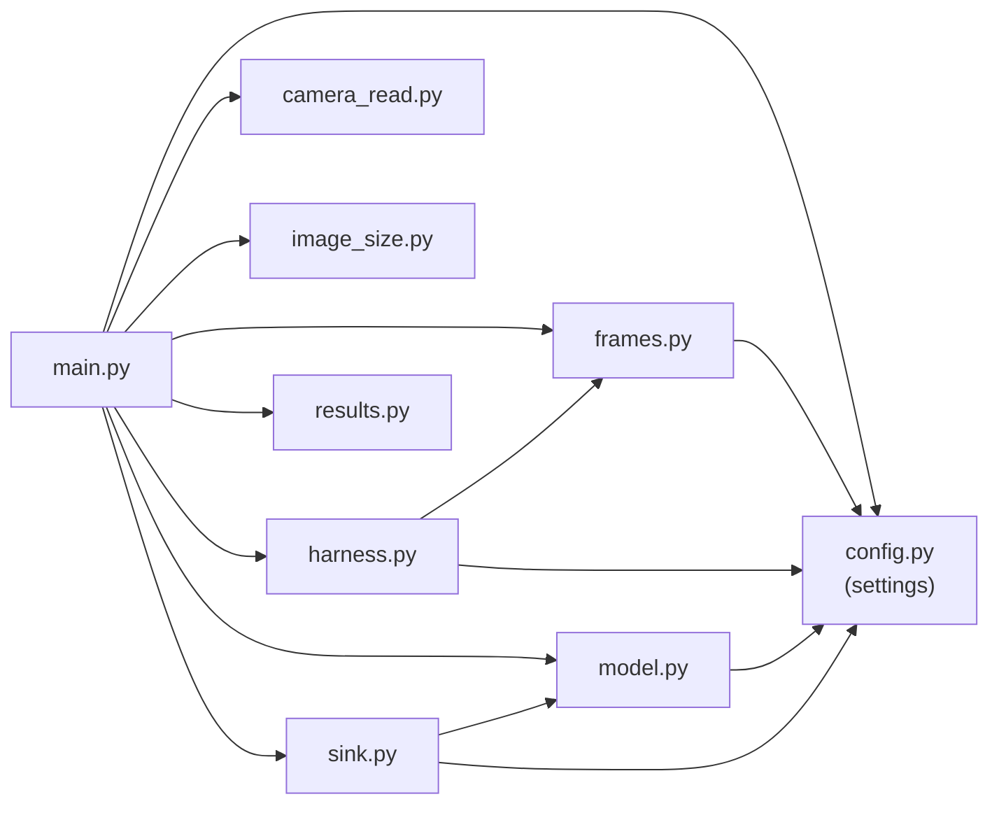
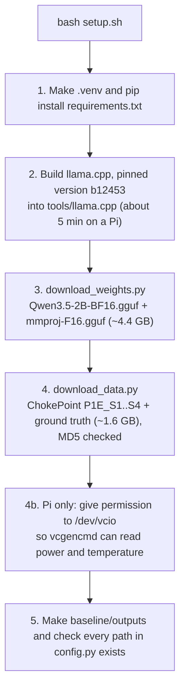
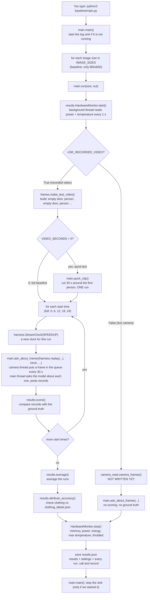
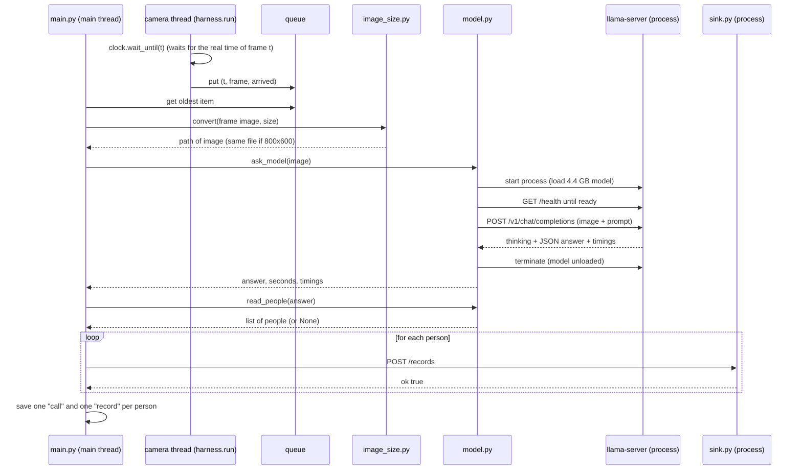
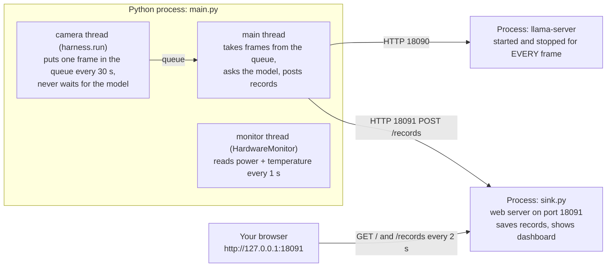

# Understanding the Baseline (A2 — Event-Triggered VLM Logging)

This file explains **everything** about the `baseline/` folder in simple English:

- what the baseline is, and why we build it
- what our end goal is
- every file, every function, and the important lines
- who calls each function, when, and why
- the full flow from `python3 baseline/main.py` to `results.json`
- what the results mean

If you have never seen this code before, read it from top to bottom. Each part builds on the one before.

---

## Table of contents

1. [The project in one minute](#1-the-project-in-one-minute)
2. [What is the baseline, and why do we need it?](#2-what-is-the-baseline-and-why-do-we-need-it)
3. [Words you need to know](#3-words-you-need-to-know)
4. [The files and folders](#4-the-files-and-folders)
5. [Before the first run: setup](#5-before-the-first-run-setup)
6. [The big picture (one diagram)](#6-the-big-picture-one-diagram)
7. [The full call order (who calls who)](#7-the-full-call-order-who-calls-who)
8. [What is running at the same time (threads and processes)](#8-what-is-running-at-the-same-time-threads-and-processes)
9. [File by file, function by function](#9-file-by-file-function-by-function)
   - [config.py](#91-configpy--all-settings)
   - [main.py](#92-mainpy--the-boss)
   - [frames.py](#93-framespy--builds-the-test-video)
   - [harness.py](#94-harnesspy--plays-the-video-like-a-live-camera)
   - [camera_read.py](#95-camera_readpy--the-live-camera-empty-for-now)
   - [image_size.py](#96-image_sizepy--changes-the-picture-size)
   - [model.py](#97-modelpy--talks-to-the-ai-model)
   - [sink.py](#98-sinkpy--the-log-sink-webhook--dashboard)
   - [results.py](#99-resultspy--scores-and-hardware-measuring)
   - [clothing_labels.json](#910-clothing_labelsjson--the-correct-clothing-answers)
10. [One frame from start to end (a real example)](#10-one-frame-from-start-to-end-a-real-example)
11. [What gets saved (output files)](#11-what-gets-saved-output-files)
12. [Every score explained](#12-every-score-explained)
13. [Our current results and what they mean](#13-our-current-results-and-what-they-mean)
14. [Why the baseline is bad (on purpose) and what fixes it later](#14-why-the-baseline-is-bad-on-purpose-and-what-fixes-it-later)
15. [Important things to remember](#15-important-things-to-remember)
16. [Questions people often ask](#16-questions-people-often-ask)
17. [The helper scripts outside `baseline/` (setup, download, deploy)](#17-the-helper-scripts-outside-baseline-setup-download-deploy)
18. [Inside llama-server: why 475 image tokens, and what the log tells us](#18-inside-llama-server-why-475-image-tokens-and-what-the-log-tells-us)
19. [History of our runs](#19-history-of-our-runs)
20. [Checklist: project requirements vs what we have done](#20-checklist-project-requirements-vs-what-we-have-done)
21. [Presentation guide (what to say, what to show, what they will ask)](#21-presentation-guide-what-to-say-what-to-show-what-they-will-ask)

---

## 1. The project in one minute

We want to build a **smart doorway camera** that runs on a **Raspberry Pi 5 (8 GB)**.

When a **new person** walks through the door, the system should:

1. notice that someone new came in,
2. ask a small AI model that can **see pictures and write text** (a VLM, "vision-language model") to describe the person, for example:
   `{"upper_color": "blue", "lower_color": "black", "outerwear": false, "bag": true, "glasses": false}`
3. **post** that description (a "record") to a log (a small web server with a live page).

Rules from the project description:

- A person counts as **new** if they are different from the **last** person logged.
  Logging the same person twice **in a row** is an error (a "duplicate").
- No face recognition, no names, no cloud models. Everything runs on the Pi.
- Targets: the time from "person enters" to "record posted" must be **short and must not keep growing**,
  and we want **at most 2 duplicate records and 2 false records per hour** of video.

**The hard part is a waiting line (a queue).** The model needs several seconds for one picture.
If pictures arrive faster than the model can answer, the line keeps growing and the delay goes up forever.
Every later improvement either makes the model **faster**, or sends it **fewer** pictures.

---

## 2. What is the baseline, and why do we need it?

### What it is

The baseline is the **simplest, most direct, slowest** version of the system. The project description tells us exactly how it must look:

| Baseline rule (from the project description) | How our code does it |
|---|---|
| Qwen3.5 **2B** model | `MODEL` in `config.py` = `Qwen3.5-2B-BF16.gguf` |
| Language part in **BF16** (16-bit, not compressed) | `Qwen3.5-2B-BF16.gguf` |
| Vision part in **F16** | `MMPROJ` = `mmproj-F16.gguf` |
| Chat template defaults, **thinking ON** | `THINKING = True` |
| The **full frame** (800×600), no cropping | `IMAGE_SIZES = [(800, 600)]` |
| One frame at a **fixed interval**, every **30 s** | `EVERY_SECONDS = 30` |
| Ask for **JSON** of every visible person | `PROMPT` in `config.py` |
| **Post every record** (no duplicate check) | `sink.post(...)` for every person in `main.py` |
| **No** person detector, **no** tracking | there is none — every 30 s we just send the whole frame |
| **No** caching | the model is **started fresh for every frame** (`model.py`) and `cache_prompt: False` |
| **No limit** on the queue | `QUEUE_SIZE = None` |

### Why we need it

The baseline is our **measuring stick**. The course says: *"progress is judged against your own baseline."*

Later we will add many improvements (keep the model loaded, a person detector, cropping, quantization, …).
For **every** change we must show numbers like "time-to-post went from X to Y". The X always comes from the baseline.
So the baseline must be:

- **correct** — it really follows the rules above,
- **repeatable** — same settings, same test video, same seed, so running it again gives the same kind of result,
- **fully measured** — every metric the project asks for is recorded (speed of each model step, memory, power, temperature, accuracy…).

The baseline is **expected to be bad**. That is fine. It is the "before" picture.

### The end goal of the baseline folder

When the baseline is finished, we can run **one command** on the Raspberry Pi and get **one file** (`results.json`) that tells us:

- How many people did we catch? (entry recall)
- How many wrong or repeated records? (false / duplicate records)
- How long until a record is posted? (time-to-post)
- How correct were the clothing descriptions? (attribute accuracy, hallucination rate)
- Where does the model spend its time? (load, encoder, prefill, decode)
- How busy is the model? Does the queue grow? Were frames dropped?
- How much memory, power, energy per record, and how hot did the Pi get?

This is Task 2 (replay harness) and Task 3 (baseline characterization) of the project.

---

## 3. Words you need to know

| Word | Simple meaning |
|---|---|
| **Frame** | One picture from a video. |
| **FPS** | Frames per second. ChokePoint video is **30 FPS**, so 1 second = 30 frames, 30 seconds = 900 frames. |
| **ChokePoint** | The public dataset we use: videos of people walking through doors, filmed from above. 800×600 pixels, 30 FPS. |
| **Sequence** | One recording session, e.g. `P1E_S1` = Portal 1, Entering, Session 1. We use `P1E_S1` … `P1E_S4`. |
| **Camera view** | ChokePoint has 3 cameras (C1, C2, C3) per door. We use **C1** only. |
| **Ground truth** | The "correct answers" file (XML) that says which person is in which frame. |
| **Visit** | One person walking through the door once (a block of frames). One person can have visits in different sequences. |
| **Test video** | A long fake "live" video we build ourselves: empty door → person → empty door → person … (see `frames.py`). |
| **Stream time** | Seconds since our fake live video started. All times in the results are stream time. |
| **Harness** | The code that **plays the test video like a real camera** on the real clock (`harness.py`). |
| **Queue** | A waiting line. Frames wait here while the model is busy. |
| **VLM** | Vision-Language Model. Looks at a picture and writes text. Ours is **Qwen3.5-2B**. |
| **llama.cpp / llama-server** | The program that runs the model on the CPU. `llama-server` is a small web server: we send it a picture + question, it sends back the answer. |
| **GGUF** | The file format llama.cpp uses for model weights. |
| **BF16 / F16** | 16-bit numbers. "Uncompressed" for our purposes. Later we compress to 8-bit or 4-bit (quantization). |
| **mmproj** | The vision part of the model (turns the picture into tokens). |
| **Token** | A small piece of text or picture the model works with. An 800×600 picture becomes **475 image tokens**. |
| **Load** | Starting `llama-server` and loading the 4.4 GB model into memory. |
| **Encoder** | The vision part: picture → image tokens. |
| **Prefill** | The model reads all input tokens (image + prompt). |
| **Decode** | The model writes the answer, one token at a time (including its "thinking"). |
| **Thinking** | Qwen3.5 first writes its reasoning inside `<think>…</think>`, then the real answer. Makes answers long and slow. |
| **Record** | One description of one person, posted to the log. |
| **Log sink** | Where records go: a small web server (`sink.py`) that saves them and shows them on a live web page. |
| **Post** | Send a record to the sink with an HTTP POST request (like a webhook). |
| **Entry recall** | Out of all people who walked in, how many we logged at least once. |
| **Duplicate record** | The same person logged twice in a row. |
| **False record** | A record when **nobody** was in the doorway. |
| **Time-to-post** | Seconds from when a person appears until their first record is posted. |
| **Attribute** | One clothing fact: upper colour, lower colour, outerwear, bag, glasses. |
| **Hallucination** | The model says something is there (bag, glasses, jacket) when the labels say it is **not**. |
| **vcgencmd** | A Raspberry Pi tool that reads power, temperature and "throttled" (slowed down because too hot). Not on a Mac. |

---

## 4. The files and folders

```
Event-Triggered-VLM-Logging-On-Edge_Project/
│
├── setup.sh               ← run once: makes .venv, builds llama.cpp, downloads model + data
├── requirements.txt       ← Python packages (numpy, opencv-python, psutil, onnxruntime)
├── download_weights.py    ← downloads the Qwen3.5-2B GGUF files into weights/
├── download_data.py       ← downloads ChokePoint P1E_S1..S4 + ground truth into data/
├── deploy_to_pi.sh        ← copies the code (and optionally data + weights) to the Pi over SSH
├── find_raspberry_pi.sh   ← (Mac) scans the network for a Raspberry Pi and prints its IP
├── pi_connection_report.txt ← result of the last Ethernet scan for the Pi
├── sources/Project_Description_AI624_2026.pdf ← the official project description
│
├── weights/qwen3.5-2b-gguf/
│   ├── Qwen3.5-2B-BF16.gguf   ← language part (~3.8 GB)
│   └── mmproj-F16.gguf        ← vision part   (~0.7 GB)
│
├── tools/llama.cpp/build/bin/llama-server   ← the program that runs the model
│
├── data/
│   ├── P1E_S1/P1E_S1_C1/00000000.jpg ...    ← the video frames (one JPG per frame)
│   │                     bg_img.txt         ← list of 100 empty-door frames
│   ├── P1E_S2/ ... P1E_S4/
│   └── groundtruth/P1E_S1_C1.xml ...        ← who is in which frame
│
└── baseline/                ← ★ everything in this guide
    ├── config.py            ← ALL settings. The only file you normally change.
    ├── main.py              ← the boss: runs every step in order, saves results
    ├── frames.py            ← builds the test video from ChokePoint
    ├── harness.py           ← plays the test video like a live camera (clock + queue)
    ├── camera_read.py       ← live camera input (EMPTY for now)
    ├── image_size.py        ← resizes a frame before the model sees it
    ├── model.py             ← starts llama-server, asks the question, reads the answer + timings
    ├── sink.py              ← the log sink: webhook server + live dashboard
    ├── results.py           ← scores + memory / power / temperature
    ├── clothing_labels.json ← correct clothing answers per person and view
    ├── README.md            ← short user guide
    ├── understanding.md     ← this file
    └── outputs/
        ├── run_<date_time>/<width>x<height>/results.json   ← one folder per run and image size
        ├── run_<date_time>/<width>x<height>/converted/      ← resized frames (only if size ≠ 800x600)
        ├── sink/records_<date_time>.jsonl                   ← every posted record, one per line
        ├── sink/sink_log.txt                                ← what the sink printed
        └── last_server_log.txt                              ← newest llama-server log
```

### How the baseline files depend on each other (imports)



- `config.py` imports nothing from the project. Everything else reads settings from it.
- `results.py` and `image_size.py` do not import project files (only the Python standard library and OpenCV).
- `sink.py` borrows one helper, `port_in_use`, from `model.py`.

---

## 5. Before the first run: setup

You run setup **once** on each machine (Mac and Pi):

```bash
bash setup.sh
```



- Each step is **skipped if it is already done**, so it is safe to run again.
- Options: `--skip-llama`, `--skip-weights`, `--skip-data`, `--hf`.
- **Why the pinned llama.cpp version?** So the Mac and the Pi run the *same* code. Results must be repeatable.
- **Why step 4b?** On Ubuntu for the Pi, a normal user cannot open `/dev/vcio`. Without it, power and temperature come out wrong or empty.

To move the code to the Pi: `bash deploy_to_pi.sh` (code only) or `bash deploy_to_pi.sh --with-data` (also data and weights, ~6 GB). Then on the Pi run `bash setup.sh`.

Then to run the baseline:

```bash
source .venv/bin/activate
python3 baseline/main.py
```

---

## 6. The big picture (one diagram)



---

## 7. The full call order (who calls who)

This is the **exact order** in which functions are called during a normal recorded-video run.
Indentation means "called inside".

```
python3 baseline/main.py
└── main.main()
    ├── sink.start_if_needed()
    │   ├── sink.is_running()                 → is a sink already answering on port 18091?
    │   ├── model.port_in_use(SINK_PORT)      → is some other program using the port?
    │   └── subprocess.Popen([python, sink.py]) → starts sink.py as its own process
    │         (inside that process: sink.main() → Sink() → ThreadingHTTPServer(Handler).serve_forever())
    │
    └── for size in IMAGE_SIZES:
        └── main.run(size, out)
            ├── results.HardwareMonitor(1).start()   → background thread: _loop() → power_watts(), temperature_c()
            ├── frames.make_test_video()
            │   ├── frames.find_visits(seq)   × 4 sequences   → read ground-truth XML
            │   └── add_empty(...)            → add 5–30 s of empty door
            ├── main.quick_clip(video, visit_starts)          → only if VIDEO_SECONDS > 0
            │
            ├── for start in start_times:
            │   ├── harness.StreamClock(SPEEDUP)
            │   ├── harness.replay(video, start, clock)       → a generator (does not run yet)
            │   ├── main.ask_about_frames(source, clock, size, folder, start)
            │   │   └── harness.run(source, clock, describe)
            │   │       ├── camera thread: for t, frame in replay(...):
            │   │       │       clock.wait_until(t) → line.put_nowait((t, frame, arrived))
            │   │       └── main thread: while item := line.get():
            │   │               describe(t, frame, arrived)      ← the inner function of ask_about_frames
            │   │               ├── image_size.convert(image, size, folder)
            │   │               ├── model.ask_model(image)
            │   │               │   ├── model.port_in_use()
            │   │               │   ├── subprocess.Popen(llama-server ...)   → loads the model
            │   │               │   ├── model.wait_until_ready(server)       → polls /health
            │   │               │   ├── model.send_question(image)           → POST /v1/chat/completions
            │   │               │   ├── server.terminate()                   → model unloaded again
            │   │               │   └── model.read_timings(reply, log, load_ms)
            │   │               │       └── model.log_time(...) × 2
            │   │               ├── model.read_people(answer)
            │   │               └── sink.post(record)  × each person found  → POST /records
            │   └── results.score(records, calls, visit_starts, seconds)
            │       └── results.mean(...) many times
            ├── results.average([...])
            ├── results.attribute_accuracy(records, clothing_labels.json)
            │   ├── results._load_labels()
            │   └── results._model_to_label() → results._colour()
            ├── results.HardwareMonitor.stop()
            │   ├── results.peak_memory_mb()
            │   └── results.vcgencmd("get_throttled")
            ├── model.llama_version()       → saved in settings
            ├── image_size.size_name(size)  → "800x600"
            └── json.dump(...) → outputs/run_<date_time>/800x600/results.json
    finally:
        sink.stop(sink_process)
```

### The same thing as a sequence diagram (one frame)



---

## 8. What is running at the same time (threads and processes)



**Why the camera has its own thread:** a real camera does not stop filming when the model is busy.
If the model takes 40 s but frames come every 30 s, frames must pile up in the queue.
That pile-up is exactly what the project wants us to measure (`waited`, `max_wait_s`).

---

## 9. File by file, function by function

### 9.1 `config.py` — all settings

**Purpose:** one place for every setting and every path. Every other file reads from here.
**Who uses it:** all other files (`from config import ...`).
**When:** at import time, before anything runs.

#### Paths

| Name | Value | Why |
|---|---|---|
| `ROOT` | the project folder (`baseline/..`) | everything else is relative to it, so the code works on the Mac and the Pi |
| `MODEL` | `weights/qwen3.5-2b-gguf/Qwen3.5-2B-BF16.gguf` | language part of the model, BF16 = baseline rule |
| `MMPROJ` | `weights/qwen3.5-2b-gguf/mmproj-F16.gguf` | vision part, F16 = baseline rule |
| `LLAMA_SERVER` | `tools/llama.cpp/build/bin/llama-server` if it exists, else `llama-server` on PATH | use the pinned build from `setup.sh` first |
| `SERVER_PORT` | `18090` | llama-server listens here |
| `SINK_PORT` | `18091` | the log sink listens here |
| `DATA`, `GROUNDTRUTH`, `OUTPUT` | `data/`, `data/groundtruth/`, `baseline/outputs/` | input frames, correct answers, results |

#### Input

| Name | Value | Why |
|---|---|---|
| `USE_RECORDED_VIDEO` | `True` | `True` = test video from ChokePoint (scoring possible). `False` = live camera (not written yet). |
| `CAMERA_SOURCE` | `0` | for the live camera later: `0` = USB webcam, or an `rtsp://` address |

#### Test split (keep the same for every run!)

| Name | Value | Why |
|---|---|---|
| `SEQUENCES` | `P1E_S1, P1E_S2, P1E_S3, P1E_S4` | the 4 recordings we build the test video from |
| `TEST_PEOPLE` | `0020` … `0027` (8 people) | the held-out test people. Only their visits go into the test video. |
| `LABELLED_PEOPLE` | same 8 | people with clothing labels (written here for reference; scoring uses the labels file) |

8 people × 4 sequences = **32 visits** in the full test video. That is why results say `people_in_video: 32`.

#### Baseline sampling

| Name | Value | Why |
|---|---|---|
| `EVERY_SECONDS` | `30` | baseline rule: one frame every 30 s |
| `START_TIMES` | `[0, 6, 12, 18, 24]` | where the 30 s clock starts. The whole test runs once for each, and the scores are averaged. See FAQ for why. |
| `VIDEO_SECONDS` | **`30` right now** | `0` = the whole video with all start times = **the real baseline**. `30` = quick check: only 30 s of video and one run. **Set it to `0` for the real result.** |

#### Replay harness

| Name | Value | Why |
|---|---|---|
| `SPEEDUP` | `1` | 1 = real time. 2 or 4 = video plays faster (frames arrive faster). The project says: always write the speed-up next to results, and report time-to-post and drops at 1×. |
| `QUEUE_SIZE` | `None` | baseline rule: no limit, nothing dropped, the line can grow. A number = drop new frames when the line is full. |

#### Image size

| Name | Value | Why |
|---|---|---|
| `IMAGE_SIZES` | `[(800, 600)]` | 800×600 = full ChokePoint frame = baseline. List more sizes (e.g. `(400, 300)`) to measure how size changes cost (Task 3 asks "cost against resolution"). Each size gets its own folder. |

#### Measuring

| Name | Value | Why |
|---|---|---|
| `MEASURE_EVERY_SECONDS` | `1` | how often power and temperature are read |

#### How the model answers (fixed, so runs repeat)

| Name | Value | Why |
|---|---|---|
| `THINKING` | `True` | baseline rule: chat template defaults, thinking ON |
| `SEED` | `0` | same random choices each time |
| `SAMPLING` | temperature 0.6, top_p 0.95, top_k 20, … | the Qwen3.5 model card's recommended settings for "thinking mode, vision tasks" |
| `PROMPT` | "Describe every person … Answer only with JSON like this: {"people": [...]}. If nobody is visible, answer {"people": []}." | the question sent with every frame. It shows the exact JSON shape we want. |

---

### 9.2 `main.py` — the boss

**Purpose:** runs every step in the right order and saves the results.
**Who calls it:** you, with `python3 baseline/main.py`. The last lines `if __name__ == "__main__": main()` start it.

At the top:

```python
LABELS = OUTPUT.parent / "clothing_labels.json"   # = baseline/clothing_labels.json
```

#### `main()`

**What it does:**
1. `sink_process = sink.start_if_needed()` — makes sure the log sink is running. If you already started `sink.py` yourself, it uses yours and returns `None`.
2. Makes a time stamp like `run_20261123_213428`.
3. For every size in `IMAGE_SIZES`, calls `run(size, OUTPUT / stamp / "800x600")`.
4. `finally: sink.stop(sink_process)` — stops the sink **only if main started it**. `finally` means this happens even if something crashes or you press Ctrl+C.

**Called by:** the `if __name__ == "__main__"` line.
**Calls:** `sink.start_if_needed`, `run`, `image_size.size_name`, `sink.stop`.

#### `run(size, out)`

**What it does:** one complete test for one image size. This is the heart of the program.

Step by step:

1. **Start measuring**
   ```python
   monitor = HardwareMonitor(MEASURE_EVERY_SECONDS)
   monitor.start()
   ```
   A background thread starts reading power and temperature.

2. **Recorded video branch** (`USE_RECORDED_VIDEO = True`):
   ```python
   video, visit_starts = make_test_video()
   ```
   Builds the long test video (a Python list of frames) and the second each person appears.

   If `VIDEO_SECONDS` is not 0, it cuts a short clip:
   ```python
   video, visit_starts, quick_start = quick_clip(video, visit_starts)
   start_times = [quick_start]
   ```

   Then for every start time:
   ```python
   clock = harness.StreamClock(SPEEDUP)                       # a new clock, starts at 0 now
   calls, records, dropped = ask_about_frames(
       harness.replay(video, start, clock), clock, size, out / "converted", start)
   run_results = score(records, calls, visit_starts, len(video) / FPS)
   run_results["dropped_frames"] = len(dropped)
   runs.append({...})
   ```
   After all start times:
   ```python
   results = average([run["results"] for run in runs])
   ```
   And then the clothing check, using **every posted record from every run together**:
   ```python
   all_records = [r for run in runs for r in run["records"] if r["posted"]]
   results.update(attribute_accuracy(all_records, LABELS))
   ```

3. **Live camera branch** (`USE_RECORDED_VIDEO = False`): uses `camera_frames(...)` with a real-time clock. You stop it with Ctrl+C. There is no ground truth, so it only counts model calls and dropped frames.

4. **Stop measuring** and add energy per record:
   ```python
   hardware = monitor.stop()
   hardware["energy_per_record_j"] = energy_j / total_records
   ```

5. **Print** every result, then **save** `results.json` with three parts: `results`, `settings`, `runs`.
   `settings` stores everything needed to repeat the run: model files, llama.cpp version (`llama_version()`), start times, speed-up, queue size, test people, thinking, seed, sampling.

**Called by:** `main()`, once per image size.

#### `ask_about_frames(source, clock, size, converted_folder, start=0)`

**What it does:** connects the camera (or replay) to the model through the harness, and collects what happened.
Returns `(calls, records, dropped)`:

- `calls` — one entry per **model call** (per frame the model looked at)
- `records` — one entry per **person found** (what was posted)
- `dropped` — frames thrown away because the queue was full (always empty in the baseline)

It defines an **inner function** `describe(t, frame, arrived)` and gives it to `harness.run(source, clock, describe)`.
The harness calls `describe` once for every frame it takes from the queue.

**Called by:** `run()`, once per start time (or once for the live camera).

##### Inner function `describe(t, frame, arrived)` — what happens to ONE frame

`t` = the second of the video the frame is from. `frame` = `{"image", "person", "visit", "view"}`. `arrived` = when it entered the queue.

```python
started = clock.now()                                   # the model takes the frame now
image = convert(frame["image"], size, converted_folder) # resize (no-op for 800x600)
prep_ms = ...                                           # time spent resizing

answer, seconds, timings = ask_model(image)             # THE SLOW PART (seconds)

parsed = read_people(answer)                            # None = answer was not valid JSON
people = parsed or []                                   # broken JSON -> treat as "no people"
parse_ms = ...

posted = [sink.post({...}) for p in people]             # post every person, no duplicate check
post_ms = ...
posted_at = clock.now()                                 # after the sink said "saved"
```

**Important line — what is posted:**
```python
sink.post({"stream_time": ..., "frame_time": t, "start": start, "image": frame["image"], "person": p})
```
Only what a **real** system would know is sent. The ground truth (`frame["person"]`, `frame["visit"]`) is **not** sent; it stays in `main.py` only for scoring. This keeps the test honest.

Then it saves one **call**:

| Field | Meaning |
|---|---|
| `frame_time` | the video second the frame is from |
| `arrived` | stream time it entered the queue |
| `started` | stream time the model took it |
| `posted_at` | stream time its records were saved by the sink |
| `waited` | `started - arrived` = time in the queue |
| `seconds` | real seconds for `ask_model` (load + encoder + prefill + decode + stop) |
| `json_ok` | was the answer valid JSON? |
| `timings` | load / encoder / prefill / decode times and token counts |
| `prep_ms`, `parse_ms`, `post_ms` | the **non-model** costs |
| `post_failures` | how many posts the sink did not confirm |
| `answer` | the full answer, thinking included |

And one **record** per person found: the description, `posted` true/false, and for scoring: `real_person`, `visit`, `view` from the ground truth.

Finally it prints one line like:
```
   24s | real:    - | found 0 | waited 0s | took 10.7s | posted at 35s
```

#### `quick_clip(video, visit_starts)`

**What it does:** for a fast test, it cuts `VIDEO_SECONDS` (30 s) of video, starting **2 s before the first person walks in**.

- It **renumbers visits** so they start at 0 inside the clip (so scoring still works).
- It picks the **start time** = the middle of the first person's visit, so the one sampled frame actually shows a person. Otherwise a 30 s check would almost always hit an empty door, and the clothing scores would be empty.

**Called by:** `run()`, only when `VIDEO_SECONDS > 0`.
**Note:** a quick clip is **not** a baseline result. It is only to check that everything works end to end.

---

### 9.3 `frames.py` — builds the test video

#### Why do we build a test video at all?

ChokePoint does **not** give one long video. It only gives the short pieces of frames **around each person walking through** (about 2 seconds each), plus **100 empty-door pictures** per sequence.

But our system is meant to watch a door **all the time**, where most of the time **nobody is there**. So we need a fake "live" stream that looks like real life:

```
[ empty 5–30 s ][ person 0020 ~2 s ][ empty 5–30 s ][ person 0021 ~2 s ][ empty ] ...
```

This lets us:

- **know the correct answer** for every frame (who is there, or nobody) → we can score recall, duplicates, false records,
- **know the exact second each person appears** (`visit_starts`) → we can measure time-to-post,
- **control** how often people come, and test the queue,
- use **only the test people**, so the test split stays fixed,
- get **the same video every time** (fixed random seed) → runs are comparable.

The project description asks for exactly this: *"compose test streams by splicing passages with stretches of empty scene between them."*

#### Settings at the top

```python
FPS = 30                 # ChokePoint is 30 frames per second
CAMERA = "C1"            # we use camera view C1
EMPTY_SECONDS = (5, 30)  # empty gap between two people: random length in this range
```

**Why random gaps?** If every gap were exactly 30 s, a check every 30 s could keep landing on the same empty moment every time. Random gaps make the test fair.

#### `find_visits(seq)`

**What it does:** reads the ground-truth XML for one sequence (e.g. `data/groundtruth/P1E_S1_C1.xml`) and groups frames into **visits**.

Returns a list like `[["0020", 1437, 1488], ["0021", 2010, 2066], ...]` = `[person, first_frame, last_frame]`.

**Important lines:**
```python
for frame in ET.parse(...).iter("frame"):
    person = frame.find("person")
    if person is None: continue                       # nobody in this frame
    if visits and visits[-1][0] == pid and n - visits[-1][2] < FPS:
        visits[-1][2] = n                             # same person, less than 1 s gap -> same visit
    else:
        visits.append([pid, n, n])                    # new visit
```
A gap of less than 1 second (30 frames) with the same person is treated as the **same** visit.

**Called by:** `make_test_video()`, once for each of the 4 sequences.

#### `make_test_video()`

**What it does:** builds the full test video as a Python list. Each item is one frame:

```python
{"image": "data/P1E_S1/P1E_S1_C1/00001467.jpg",
 "person": "0020",       # who is really there (None if empty)
 "visit": 0,             # which visit number (None if empty)
 "view": "P1E_C1"}       # portal + camera (clothing labels are per view)
```

Also returns `visit_starts` = the second each visit starts in the test video, e.g. `[12.4, 45.1, ...]`.

**How (step by step):**
1. `rng = random.Random(0)` — fixed seed: **the same test video every run**.
2. For each sequence:
   - read `bg_img.txt` to get the list of empty-door pictures,
   - for each visit from `find_visits` that belongs to a **test person**:
     - `add_empty(empty)` — add a random 5–30 s of empty door (cycling through the 100 empty pictures),
     - write down `visit_starts.append(len(video) / FPS)` — the second this person appears,
     - add every frame of the visit (skips missing JPGs).
3. Add one last empty gap at the end.

**Note:** the video list stores **file paths**, not pictures, so it uses almost no memory.

**Called by:** `main.run()`, once per image size, at the start (only for recorded video).

#### `add_empty(empty)` (inner function)

Adds `random(5..30) × 30` empty frames, using `empty[i % len(empty)]` so the 100 empty pictures repeat in a loop.

---

### 9.4 `harness.py` — plays the video like a live camera

**Purpose:** a real camera gives you frames **on the real clock**, and **does not wait** for your model. The harness copies this behaviour with the recorded video, so the test is realistic. This is Task 2 of the project.

```
camera thread                     queue                     model (main thread)
one frame every 30 s   ----->  [frame][frame]...  ----->   takes the oldest frame,
never waits for the model                                  describes it, posts it
```

#### `class StreamClock`

**What it does:** counts **stream seconds** = seconds of video since the stream started.

```python
def now(self):
    return (time.monotonic() - self.start) * self.speedup
```
- With `SPEEDUP = 1`, 1 real second = 1 stream second.
- With `SPEEDUP = 2`, 1 real second = 2 stream seconds (video plays twice as fast).
- `time.monotonic()` is a clock that never jumps back (safe for measuring time).

```python
def wait_until(self, t):
    delay = (t - self.now()) / self.speedup
    if delay > 0: time.sleep(delay)
```
Sleeps until stream time `t`. If we are already late, it does not sleep.

**Created by:** `main.run()`, a **new clock for every start time** (so each run starts at 0).
**Used by:** `replay` (to wait), `ask_about_frames` (to stamp `started`, `posted_at`), `harness.run` (to stamp `arrived`).

#### `replay(video, start, clock)`

**What it does:** gives one frame every `EVERY_SECONDS`, starting at `start`, each at its correct moment.

```python
for t in range(start, len(video) // FPS, EVERY_SECONDS):   # t = 6, 36, 66, ... (if start = 6)
    clock.wait_until(t)                                    # wait for the real time
    yield t, video[t * FPS]                                # second t = frame number t*30
```

- It is a **generator** (`yield`): it does nothing until someone loops over it. That someone is the camera thread inside `harness.run`.
- `video[t * FPS]`: second 30 → frame 900.
- It gives `(t, frame)` — the **same shape** as `camera_read.camera_frames()`. That is why `main.py` works with both the recorded video and the live camera without changes.

**Called by:** `main.run()` creates it and passes it to `ask_about_frames` → `harness.run` loops over it.

#### `run(source, clock, handle)`

**What it does:** runs the camera and the model **side by side**.

```python
line = queue.Queue(maxsize=QUEUE_SIZE or 0)   # 0 = no limit
dropped = []
end = object()                                 # a special "video is over" marker

def camera():                                  # runs in its own thread
    for t, frame in source:
        arrived = clock.now()
        try:
            line.put_nowait((t, frame, arrived))      # never waits
        except queue.Full:
            dropped.append({...}); print("DROPPED")   # only when QUEUE_SIZE is a number
    line.put(end)                              # tell the main thread we are done

threading.Thread(target=camera, daemon=True).start()
while (item := line.get()) is not end:         # main thread: take the oldest frame
    handle(*item)                              # = describe(t, frame, arrived)
return dropped
```

**Important points:**
- `put_nowait` = the camera **never waits**. If the queue is full, the frame is **dropped** and written down.
- In the baseline, `QUEUE_SIZE = None` → no limit → nothing is ever dropped, but frames can wait longer and longer.
- `line.get()` **blocks**: the main thread waits here until a frame arrives.
- `end` marker: when the video is over, the camera puts `end` in the line, and the loop stops after every real frame is handled.
- `daemon=True`: the camera thread will not keep Python alive if the main program ends.

**Called by:** `main.ask_about_frames()`.
**Calls:** `handle` = `describe` for every frame.

---

### 9.5 `camera_read.py` — the live camera (empty for now)

**Purpose:** later, read frames from a USB webcam or a phone/IP camera (RTSP).
**Right now:** `camera_frames()` just raises `NotImplementedError` with the message "set `USE_RECORDED_VIDEO = True`".

**What it must do when written** (from its docstring):
- give frames as `(t, frame)` exactly like `harness.replay()`,
- `t = clock.now()` when the frame was taken,
- `frame = {"image": "path/to/saved.jpg", "person": None, "visit": None, "view": None}` (no ground truth for live video),
- take one frame every `EVERY_SECONDS`, and **never wait for the model**.

**Called by:** `main.run()` only when `USE_RECORDED_VIDEO = False`.

---

### 9.6 `image_size.py` — changes the picture size

**Purpose:** Task 3 asks for "per-record VLM cost against resolution". The vision part of Qwen3.5 works at the picture's real size, so **a smaller picture = fewer image tokens = faster**. This file makes the smaller copy.

#### `convert(image, size, folder)`

```python
img = cv2.imread(str(source))
if (width, height) == (target_width, target_height):
    return str(source)                     # 800x600: nothing to do, use the original
small = cv2.resize(img, (target_width, target_height), interpolation=cv2.INTER_AREA)
cv2.imwrite(str(target), small, [cv2.IMWRITE_JPEG_QUALITY, 95])
return str(target)
```

- The **original is never changed**. The small copy goes into `run_.../<size>/converted/`.
- `INTER_AREA` is a good way to make pictures smaller.
- JPEG quality 95: so the **only** change is the size, not extra blur from compression.
- It converts **every time** (no reuse), so the time is always measured as `prep_ms` (non-model cost).
- Even at 800×600 it still reads the image once (`cv2.imread`), so `prep_ms` is about 11 ms, not 0.

**Called by:** `describe()` in `main.py`, once per frame.

#### `size_name(size)`

`(800, 600)` → `"800x600"`. Used for folder names and in the results.
**Called by:** `main.main`, `main.run`, `describe`.

---

### 9.7 `model.py` — talks to the AI model

**Purpose:** start `llama-server`, send one picture + the prompt, get the answer, measure every step, and read the JSON.

**Baseline rule here: no caching.** For **every** frame:
1. start `llama-server` (loads the 4.4 GB model),
2. wait until it is ready,
3. ask the question,
4. **stop** the server.

So the model is loaded again for every frame. This is slow on purpose (Task 4 later keeps it loaded).

#### `ask_model(image)` → `(answer, seconds, timings)`

```python
if port_in_use(): raise RuntimeError(...)            # another program on 18090? stop early, clear message
start = time.time()
server = subprocess.Popen([LLAMA_SERVER, "-m", MODEL, "--mmproj", MMPROJ,
                           "--port", "18090",
                           "-c", "8192",              # context: room for image + prompt + answer
                           "-lv", "4"],               # log level "trace": prints encoder timings
                          stdout=log, stderr=log)
try:
    wait_until_ready(server)
    load_ms = (time.time() - start) * 1000            # time to start + load the model
    reply = send_question(image)
finally:
    server.terminate(); server.wait()                 # baseline: unload, every time
    (OUTPUT / "last_server_log.txt").write_text(log_text)   # keep the newest log, even on error
timings = read_timings(reply, log_text, load_ms)
answer = f"<think>{reasoning_content}</think>{content}"
return answer, round(time.time() - start, 1), timings
```

**Important points:**
- `-lv 4` is needed because the **encoder time** is only printed in the server's trace log. Without it we could not split "encoder" from "prefill".
- `finally` makes sure the server is stopped even if the question fails, so the port is free for the next frame.
- llama-server gives the thinking in a separate field (`reasoning_content`). We put it back in `<think>` tags so the full answer is saved.
- `seconds` = **everything**: start server + load + encoder + prefill + decode + stop. This is the real cost of one frame in the baseline.

**Called by:** `describe()` in `main.py`, once per frame.

#### `wait_until_ready(server)`

Asks `http://127.0.0.1:18090/health` every 0.2 s until it answers.
If the server process **died** while starting (`server.poll() is not None`), it raises an error telling you to look at `last_server_log.txt` and check `MODEL`, `MMPROJ`, `LLAMA_SERVER`.
**Called by:** `ask_model()`.

#### `port_in_use(port=SERVER_PORT)`

Tries to connect to the port. `True` = some program is already listening there.
**Called by:** `ask_model()` (port 18090) and `sink.start_if_needed()` (port 18091).

#### `send_question(image)`

Builds the request in the OpenAI chat format and sends it to `/v1/chat/completions`:

```python
picture = base64.b64encode(open(image, "rb").read()).decode()   # picture as text
question = {
    "messages": [{"role": "user", "content": [
        {"type": "image_url", "image_url": {"url": f"data:image/jpeg;base64,{picture}"}},
        {"type": "text", "text": PROMPT}]}],
    "max_tokens": 4096,                 # stop very long thinking from running forever
    "cache_prompt": False,              # baseline: no caching
    "chat_template_kwargs": {"enable_thinking": THINKING},
    "seed": SEED,
    **SAMPLING,                          # temperature, top_p, top_k, ...
}
```
Returns the reply as a Python dict.
**Called by:** `ask_model()`.

#### `read_timings(reply, log, load_ms)`

Splits the time of one model call into steps. Uses **two sources**:
- `reply["timings"]` from llama-server: `prompt_ms`, `predicted_ms`, `prompt_n`, `predicted_n`,
- the **trace log** text, for the encoder.

| Key | How it is found | Meaning |
|---|---|---|
| `load_ms` | measured in `ask_model` | start server + load model |
| `encoder_ms` | log time of "decoding image batch" − log time of "encoding mtmd batch" | vision part: picture → tokens |
| `prefill_ms` | `prompt_ms − encoder_ms` | reading all tokens. (llama-server's `prompt_ms` **includes** the encoder, so we subtract it.) |
| `image_prefill_ms` | sum of "image decoded … in N ms" lines | the part of prefill that reads the image tokens |
| `decode_ms` | `predicted_ms` | writing the answer (thinking included) |
| `image_tokens` | sum of `n_tokens_batch = N` | how many tokens the picture became (475 for 800×600) |
| `prompt_tokens` | `prompt_n` | image + text tokens |
| `decode_tokens` | `predicted_n` | answer length |

So: **load + encoder + prefill + decode ≈ total time** of one call.
**Called by:** `ask_model()`.

#### `log_time(text, log)`

Finds the first log line containing `text` and turns its time stamp into seconds.
Log lines start like `0.01.451.703` = minutes.seconds.milliseconds.microseconds.
**Called by:** `read_timings()` (twice).

#### `llama_version()`

Runs `llama-server --version` and returns the version text. Saved in `settings` so we always know **which llama.cpp build** made a result (the project requires this).
**Called by:** `main.run()` when saving.

#### `read_people(answer)` → list of people, or `None`

```python
answer = re.sub(r"<think>.*?</think>", "", answer, flags=re.DOTALL)   # remove the thinking
data = json.loads(answer[answer.index("{"):answer.rindex("}") + 1])  # from the first { to the last }
people = data.get("people", [])
if not isinstance(people, list): return None                         # "people": "none" is not valid
return [p for p in people if isinstance(p, dict)]
```
- Removing `<think>` first is important: the thinking text often contains `{` and `}` too.
- Taking from the first `{` to the last `}` also handles answers wrapped in ```` ```json ```` fences.
- `None` = broken answer → counted as `json_ok = false`, and treated as "no people".

**Called by:** `describe()` in `main.py`, once per frame.

---

### 9.8 `sink.py` — the log sink (webhook + dashboard)

**Purpose:** the project says records must be **posted to a log sink** (dashboard, webhook or broker). This file is that sink: a tiny web server that **receives** records, **saves** them to a file, and **shows** them live in your browser. It uses only Python's standard library.

It has **two halves**:

#### Half 1 — client functions (used by `main.py`)

| Function | What it does | Called by |
|---|---|---|
| `is_running()` | GET `/health`; `True` if a sink answers `{"sink": true}` | `start_if_needed()` |
| `start_if_needed()` | if no sink is running: check the port is free, start `python sink.py` as a **separate process** (its output goes to `outputs/sink/sink_log.txt`), wait up to 10 s until it answers. Returns the process, or `None` if one was already running. | `main.main()` at the start |
| `post(record)` | POST the record as JSON to `/records` (5 s timeout). `True` only if the sink answers `{"ok": true}`. **No retry** (baseline). | `describe()` once per person |
| `stop(process)` | stops the sink, **only if main started it** (process is not `None`) | `main.main()` in `finally` |

**Why a separate process?** Like a real webhook, the sink is a different program. Posting goes over HTTP, so `post_ms` is a real cost, and a failed post is a real failure (`post_failures`).

#### Half 2 — the server (runs when you start `sink.py`)

| Part | What it does |
|---|---|
| `class Sink` | creates a new file `outputs/sink/records_<date_time>.jsonl`. `add(record)` adds `received_at`, keeps it in memory, and appends one JSON line to the file. A `lock` makes it safe when two requests come at once. |
| `class Handler` | answers web requests: |
| → `do_POST /records` | read JSON, `SINK.add(...)`, print `record N: frame Xs {...}`, answer `{"ok": true, "n": N}`. Bad JSON → 400. |
| → `GET /health` | `{"sink": true, "records": N, "file": "..."}` |
| → `GET /records` | all records so far (the dashboard reads this) |
| → `GET /frame?path=...` | sends the frame JPG for the thumbnail. **Only** files inside `data/` and ending in `.jpg` (so nobody can read other files). |
| → `GET /` | the dashboard web page |
| `DASHBOARD` | an HTML page that every 2 s fetches `/records` and shows a table: thumbnail, video second, posted at, upper, lower, outerwear, bag, glasses. Newest first. Works in light and dark mode. |
| `main()` | creates `SINK`, starts `ThreadingHTTPServer` on `127.0.0.1:18091`, runs until Ctrl+C |

**How to watch it live:** in a second terminal run `python3 baseline/sink.py`, open `http://127.0.0.1:18091`, then run `main.py`. Main sees the sink is running and uses it (and leaves it running).

**Note:** a new `.jsonl` file is made **each time the sink starts**, not each run. If you keep one sink open over many runs, all their records go into one file. The `start` field in each record tells you which start time it came from.

---

### 9.9 `results.py` — scores and hardware measuring

**Purpose:** everything we measure. Four groups: **scores**, **attribute accuracy**, **memory**, **power & temperature**.

#### `score(records, calls, visit_starts, stream_seconds)`

**What it does:** compares what was logged with the ground truth for **one run**.
**Called by:** `main.run()`, once per start time.

Main loop (in order of posting):
```python
for r in records:
    if not r.get("posted", True): continue          # the sink didn't save it -> it was not logged
    if r["real_person"] is None:                     # nobody was in the frame
        false_records += 1; last = None; continue
    duplicates += r["real_person"] == last           # same person as the last record -> duplicate
    last = r["real_person"]
    if r["visit"] not in found:                      # first time this visit is logged
        found.add(r["visit"])
        first_post.append(r["posted_at"] - visit_starts[r["visit"]])   # time-to-post
```

Notes:
- A false record **resets** `last`, because the log now has another "person" in between.
- If the model describes **2 people** in one frame where the ground truth has one person, both records get the same `real_person` → the second counts as a **duplicate**. That is correct by the project rule.
- Time-to-post uses the **first** record of each visit.

Then it builds many numbers (see [section 12](#12-every-score-explained)): recall, duplicates, false records, time-to-post, busy %, waits, post failures, the average of each model step, per-hour rates, service rate, and non-model cost.

#### `_load_labels(labels_path)`

Reads `clothing_labels.json` and returns a dict keyed by `(subject_id, view)`, e.g. `("0020", "P1E_C1") → {upper_colour, lower_colour, outerwear, bag, glasses}`.
**Why per view?** The two doors were filmed **a month apart**, so people wear different clothes.
**Called by:** `attribute_accuracy()`.

#### `_colour(value)`

Lower case, trim spaces, and `grey` → `gray` (labels use `gray`).
**Called by:** `_model_to_label()`.

#### `_model_to_label(description)`

Translates the model's words into the labels' words:

| Model says | Labels say | Translation |
|---|---|---|
| `upper_color: "Grey"` | `upper_colour: "gray"` | `_colour()` |
| `outerwear: true / false` | `"none"` or a type (`"jacket"`, `"hoodie"` …) | `false → "none"`, `true → "present"` |
| `bag: true / false` | `"present" / "absent"` | direct |
| `glasses: true / false` | `"present" / "absent"` | direct |

**Called by:** `attribute_accuracy()`.

#### `attribute_accuracy(records, labels_path)`

**What it does:** checks how correct the clothing descriptions are.
**Called by:** `main.run()`, once, with **all posted records from all runs together**.

For each record whose `(real_person, view)` has a label, for each of the 5 fields:
- **colours**: must match **exactly** (e.g. `"dark grey"` ≠ `"gray"`, `"light gray"` ≠ `"white"`),
- **bag / glasses**: `present` must equal `present`,
- **outerwear**: label `none` → model must say none/false; any jacket/hoodie → model must say present/true.

It also counts **hallucinations**: for bag, glasses, outerwear where the label says **absent/none**, did the model say it is there?

Returns: accuracy per field, `attribute_accuracy` (all fields), `attribute_comparisons`, `hallucination_rate`, `hallucination_comparisons`, `subjects_with_labels`.
If the labels file is missing → `{"attribute_accuracy": None, "note": "no labels file found"}`.

#### `mean(values)` and `average(runs)`

- `mean`: average of a list, **skipping `None`**. Returns `None` if nothing is left.
- `average`: averages a list of result dicts key by key. Text values (like `"800x600"`) are kept as they are.
**Called by:** `score()` (`mean`), `main.run()` (`average`), `HardwareMonitor.stop()` (`mean`).

#### `peak_memory_mb()`

The highest RAM any **child process** used so far (llama-server, and the sink if main started it). Uses `resource.getrusage(RUSAGE_CHILDREN)`. Mac gives bytes, Linux gives KB, so it converts both to MB.
**Called by:** `HardwareMonitor.stop()`.

#### `vcgencmd(*args)`

Runs a Raspberry Pi `vcgencmd` command and returns its text. Returns `None` if:
- not on a Pi (the tool does not exist), or
- the tool failed (e.g. "Can't open device file: /dev/vcio" — no permission). Then it prints one warning (via `_warn_once`) telling you to run `setup.sh`.

**Why so careful?** Before this, an error message was read as a number and gave fake results (`max_temp_c 100.0`, `avg_power_w 0.0`). Now an error is saved as `None`, never as a wrong number.

#### `_warn_once(message)`

Prints a warning only the first time, so the screen is not flooded every second.

#### `power_watts()`

Runs `vcgencmd pmic_read_adc`, which lists every power line (rail) with its volts and amps. Power = **sum of volts × amps over all rails**. If the output is not understood → `None` (unknown, not 0 W).

#### `temperature_c()`

First `vcgencmd measure_temp` (looks like `temp=52.1'C`). If that does not work, it reads the Linux sensor `/sys/class/thermal/thermal_zone0/temp` (millidegrees). `None` on a Mac.

#### `class HardwareMonitor`

| Method | What it does |
|---|---|
| `__init__(every_seconds)` | empty lists for power and temperature |
| `start()` | remembers the start time, starts a background thread running `_loop` |
| `_loop()` | every `MEASURE_EVERY_SECONDS`: append `power_watts()` and `temperature_c()` |
| `stop()` | stops the thread and returns: `peak_memory_mb`, `avg_power_w`, `energy_j = avg_power × seconds`, `max_temp_c`, `throttled` (e.g. `throttled=0x0` = never slowed down) |

**Called by:** `main.run()` — `start()` at the very beginning, `stop()` after all runs.
**Note:** it measures the **whole** test (all start times), so energy is for everything, and `energy_per_record_j` divides by all records.

---

### 9.10 `clothing_labels.json` — the correct clothing answers

ChokePoint has **no clothing labels**, so the team labelled them by hand (the project asks for 4–6 attributes per person and portal).

- 45 keys, for people `0010`–`0029`, each per `view` (e.g. `P1E_C1`).
- Each key has `attributes`: `upper_colour`, `lower_colour`, `outerwear`, `bag`, `glasses`.
- It also has `evidence_by_field` (which frames prove each label) and info about who labelled it and which labels were left out because the two labellers disagreed.

Only `keys[].subject_id`, `keys[].view` and `keys[].attributes` are used by the code (`_load_labels`).

---

## 10. One frame from start to end (a real example)

From the run `run_20261119_225731` (on the Mac), start time `24`:

```
Stream time 0 s    clock starts (StreamClock created)
Stream time 24 s   replay(): clock.wait_until(24) finishes
                   frame = video[24 * 30] = video[720] = data/P1E_S1/P1E_S1_C1/00000058.jpg (empty door)
                   camera thread: arrived = 24.0, put in queue
                   main thread: takes it at once (queue was empty) → started = 24.0, waited = 0.0
                   convert(): 800x600 already → same file
                   ask_model():
                       load      3896 ms   (start llama-server, load the model)
                       encoder    514 ms   (picture → 475 image tokens)
                       prefill    507 ms   (read 552 tokens)
                       decode    5654 ms   (write 236 tokens: thinking + JSON)
                       total     10.7 s
                   answer ends with: ```json {"people": []} ```
                   read_people() → []    → nobody to post
Stream time 34.7 s posted_at = 34.7
Stream time 54 s   next frame (24 + 30) ...
```

And a frame **with** a person (start 24, frame at 114 s): the model answered
`{"upper_color": "red", "lower_color": "white", "outerwear": true, "bag": false, "glasses": true}`,
it was posted at 121.4 s, and the ground truth says it was really person `0026`, visit 5, view `P1E_C1`.

Picture of the timeline:

```
stream time →  0 s        24 s           34.7 s      54 s           64.x s     84 s
camera:        |----------[frame 24]--------------------[frame 54]----------------[frame 84]
model:                    [load|enc|pre|  decode  ]     [load|enc|pre|  decode  ]
                          ^started            ^posted   ^started           ^posted
queue:         empty the whole time (the model takes ~10 s, frames come every 30 s)
```

Because one call (~8–11 s on the Mac) is **shorter** than 30 s, the queue never grows on the Mac (`avg_wait_s = 0`).
On the Pi, a call is much slower. If it is longer than 30 s, frames start to wait, and `avg_wait_s` / `max_wait_s` grow — that is the "backlog" the project talks about.

---

## 11. What gets saved (output files)

| File | Made by | What is in it |
|---|---|---|
| `outputs/run_<date_time>/<W>x<H>/results.json` | `main.run()` | everything (see below) |
| `outputs/run_<date_time>/<W>x<H>/converted/*.jpg` | `image_size.convert()` | resized frames (only if the size is not 800×600) |
| `outputs/sink/records_<date_time>.jsonl` | `sink.Sink.add()` | one posted record per line, with `received_at` |
| `outputs/sink/sink_log.txt` | the sink process (if main started it) | what the sink printed |
| `outputs/last_server_log.txt` | `model.ask_model()` | the **newest** llama-server log (overwritten every frame). Look here when something breaks. |

### Inside `results.json`

```json
{
  "results":  { ...averaged scores + attribute accuracy + memory/power/temperature... },
  "settings": { "source", "image_size", "every_seconds", "start_times", "video_seconds",
                "speedup", "queue_size", "sink", "model", "mmproj", "llama_cpp",
                "sequences", "test_people", "thinking", "seed", "sampling" },
  "runs": [
    { "start": 0,
      "results": { ...scores of this run only... },
      "calls":   [ { frame_time, image, image_size, arrived, started, posted_at, waited,
                     seconds, json_ok, timings{...}, prep_ms, parse_ms, post_ms,
                     post_failures, answer } , ... ],
      "records": [ { posted_at, frame_time, description{...}, posted,
                     real_person, visit, view } , ... ],
      "dropped": [ ... ] },
    ...
  ]
}
```

Because every answer and every timing is saved, you can **check any number by hand** later.

---

## 12. Every score explained

| Score | Formula (simple) | What it tells you |
|---|---|---|
| `people_in_video` | number of visits | 32 in the full test video |
| `people_logged` | visits with at least one posted record | how many we caught |
| `entry_recall` | `people_logged / people_in_video` | **main accuracy number**. 1.0 = caught everyone |
| `duplicate_records` | same person twice in a row | target: ≤ 2 per hour |
| `false_records` | records when nobody was there | target: ≤ 2 per hour |
| `duplicates_per_hour`, `false_records_per_hour` | count ÷ hours of video | compare with the target |
| `avg_time_to_post_s` | avg of (first `posted_at` − person appears) | how fast we log a new person |
| `model_calls` | number of frames the model looked at | |
| `json_ok_rate` | valid JSON answers ÷ calls | if low → constrain the output later |
| `avg_seconds_per_call` | avg real seconds of `ask_model` | full cost of one frame |
| `model_busy_percent` | time the model worked ÷ (whole stream or until last post) | the "VLM duty cycle" |
| `avg_wait_s`, `max_wait_s` | time frames waited in the queue | grows if the model is too slow → backlog |
| `dropped_frames` | frames thrown away (queue full) | always 0 in the baseline |
| `post_failures` | records the sink did not save | |
| `avg_post_ms` | time spent posting (successful frames) | non-model cost |
| `avg_load_ms` | start server + load model | removed later by keeping the model loaded |
| `avg_encoder_ms` | picture → tokens | depends on picture size |
| `avg_prefill_ms` | reading all tokens | |
| `avg_image_prefill_ms` | part of prefill for image tokens | |
| `avg_decode_ms` | writing the answer | long because of thinking |
| `avg_image_tokens` | tokens from the picture | 475 at 800×600 |
| `avg_prompt_tokens`, `avg_decode_tokens` | input and output length | |
| `service_rate_frames_per_s` | `1 / avg seconds per call` | how many frames per second the model can handle (µ) |
| `highest_stable_interval_s` | `avg seconds per call` | frames closer together than this → queue grows forever |
| `avg_prep_ms`, `avg_parse_ms`, `avg_non_model_ms` | resize, read JSON, + post | the non-model path cost |
| `non_model_share_percent` | non-model time ÷ total time | how much is **not** the model |
| `upper_colour` … `glasses` | correct ÷ compared, per field | clothing accuracy per attribute |
| `attribute_accuracy` | all correct ÷ all compared | overall clothing accuracy |
| `hallucination_rate` | said "present" when label says absent ÷ absent cases | making things up |
| `peak_memory_mb` | highest RAM of child processes | |
| `avg_power_w`, `energy_j`, `energy_per_record_j` | from `vcgencmd` | Pi only |
| `max_temp_c`, `throttled` | hottest temperature, slowed down? | Pi only |

**The queue rule in one line:** frames arrive every `EVERY_SECONDS` (rate λ = 1/30 per s). The model handles `service_rate_frames_per_s` (µ). If λ > µ, i.e. `avg_seconds_per_call` > 30 s, the queue grows without end.

---

## 13. Our current results and what they mean

These are from the newest full run, `run_20261123_213428/800x600` (5 start times, **on the Mac**, not yet on the Pi):

| Score | Value | Meaning |
|---|---|---|
| `entry_recall` | **0.031** (1 of 32) | we catch almost nobody: people are visible for about 2 s, we look every 30 s |
| `duplicate_records`, `false_records` | 0, 0 | good, but only because we post so few records |
| `avg_time_to_post_s` | 9.4 s | when we do catch someone, it takes ~9 s |
| `avg_seconds_per_call` | 8.4 s | one frame costs 8.4 s |
| — `avg_load_ms` | 2453 ms (~29 %) | reloading the model every frame |
| — `avg_encoder_ms` | 547 ms (~7 %) | picture → 475 tokens |
| — `avg_prefill_ms` | 518 ms (~6 %) | |
| — `avg_decode_ms` | 4755 ms (~57 %) | **the biggest cost**: ~196 tokens, mostly thinking |
| `model_busy_percent` | 28 % | model works 8.4 s out of each 30 s |
| `avg_wait_s` | 0 | on the Mac, the queue never grows |
| `json_ok_rate` | 1.0 | every answer was valid JSON |
| `avg_non_model_ms` | 11.8 ms (0.14 %) | almost all the time is the model |
| `attribute_accuracy` | 0.8 (25 comparisons) | colours are the weak part (upper 0.6, lower 0.4) |
| `hallucination_rate` | 0.0 (11 cases) | did not invent bags/glasses/jackets in these few cases |
| `peak_memory_mb` | 4871 MB | the BF16 model is big |
| power, energy, temperature | `None` | the Mac has no `vcgencmd` — **these need the Pi** |

**What is still missing for a complete baseline:** the full run (with `VIDEO_SECONDS = 0`) **on the Raspberry Pi**, so that power, energy, temperature and the real (much slower) model times are measured. That is what the project requires: *"baseline characterized on the Pi."*

---

## 14. Why the baseline is bad (on purpose) and what fixes it later

| Weakness | Why it happens | Fixed later by |
|---|---|---|
| Catches almost nobody (3 % recall) | looks every 30 s, but people are visible ~2 s | a change gate + person detector + tracker that call the model **once per new person** (Task 5) |
| Reloads the model every frame (~30 % of time) | baseline rule: no caching | a **persistent** llama-server with the prompt cached (Task 4) |
| Decode is most of the time | thinking ON makes answers long | shorter answers, thinking off, or schema-constrained output |
| Queue has no limit | baseline rule | a **bounded queue** with a clear drop policy (Task 4) |
| 475 image tokens for the full frame | sends the whole 800×600 picture | **crop** to the person and try smaller sizes (Task 6) |
| ~4.9 GB memory | BF16/F16 weights | **quantization** of decoder and encoder (Task 7) |
| Colour mistakes | small picture of the person, exact colour match | cropping, better frame choice, LoRA fine-tune (Tasks 6, 8) |

Each improvement must be added **on top of the last one**, measured with **the same test video and the same scores**, and marked "kept" or "discarded" with the reason. The baseline is step 0 of that chain.

---

## 15. Important things to remember

1. **`VIDEO_SECONDS` is set to `30` right now.** That is the quick-test mode (one 30 s clip, one run). For the **real baseline result**, set `VIDEO_SECONDS = 0` in `config.py`.
2. **The real baseline must run on the Raspberry Pi.** The Mac results have no power, energy or temperature, and the Mac is much faster.
3. **Do not change `SEQUENCES`, `TEST_PEOPLE`, `EVERY_SECONDS`, `SEED`, `SAMPLING`, `PROMPT`** between runs you want to compare. Otherwise the numbers are not comparable.
4. **`SPEEDUP` must be written next to every result**, and the official time-to-post and dropped frames are at `SPEEDUP = 1`.
5. **Port errors:** if 18090 or 18091 is busy, change `SERVER_PORT` / `SINK_PORT` in `config.py`.
6. **When llama-server fails**, read `baseline/outputs/last_server_log.txt`.
7. **On the Pi, run `setup.sh` once** so `vcgencmd` has permission; otherwise power/temperature are `None` and a warning is printed.
8. **Colour matching is exact.** `"dark grey"` does not match `"gray"`. This makes colour accuracy look lower than it "feels". Keep the rule the same for every run so comparisons stay fair.
9. **Attribute accuracy uses all runs pooled together**, not averaged per run.
10. **The live camera (`camera_read.py`) is not written yet.** `USE_RECORDED_VIDEO = False` will stop with an error.
11. The README says "use `START_TIMES = [0]` for a quick test". Now `VIDEO_SECONDS > 0` does this job (it uses one start time by itself), so you do not need to touch `START_TIMES`.

---

## 16. Questions people often ask

**Why do we make a test video instead of just using the ChokePoint frames?**
ChokePoint only gives short pieces around each person. A real door is empty most of the time. `make_test_video()` builds a realistic long stream (empty → person → empty …), with the correct answer for every frame and the exact second each person appears. Without it we cannot measure recall, false records, duplicates or time-to-post. See [9.3](#93-framespy--builds-the-test-video).

**Who calls `make_test_video()`, and when?**
`main.run()` calls it **once per image size**, right after starting the hardware monitor, and only when `USE_RECORDED_VIDEO = True`. It uses `find_visits()` for each of the 4 sequences. Its output (`video`, `visit_starts`) is used by `quick_clip()` (quick mode), by `harness.replay()` (to pick frames), and by `results.score()` (to check recall and time-to-post).

**Why 5 start times?**
A person is visible for about 2 s. Whether a check every 30 s lands on them depends on luck: starting the clock at 0 s may catch 0 people, starting at 12 s may catch 3. Running with 5 start times (0, 6, 12, 18, 24 — spread over the 30 s) and averaging removes that luck.

**Why does the camera run in its own thread?**
A real camera does not wait for the model. If the model is slow, frames must pile up (or be dropped). Measuring that pile-up (`waited`) is a project requirement.

**Why start and stop llama-server for every frame? Isn't that wasteful?**
Yes, on purpose. The baseline rule says "no caching". Measuring how much time this wastes (`avg_load_ms`) shows the value of keeping the model loaded later (Task 4).

**Why is thinking ON if it is slow?**
The baseline must use the chat template's **defaults**, and for Qwen3.5 that includes thinking. Turning it off is a later improvement that we measure.

**Why do we post to a separate web server instead of just writing a file?**
The project says records must go to a log sink (dashboard / webhook / broker). Posting over HTTP is what a real system would do, it lets us measure posting time and failures, and the dashboard lets you watch records arrive live.

**Why don't we send the ground truth to the sink?**
The sink is what a real system would see. A real system does not know who the person really is. The ground truth stays in `main.py` only for scoring.

**What does `real: -` mean in the printed line?**
The door was empty in that frame (ground truth has no person).

**Why is `avg_wait_s` 0?**
On the Mac one call takes ~8 s, less than the 30 s between frames, so frames never wait. On the Pi a call is much slower; if it goes above 30 s, waits will appear and keep growing.

**What is the one most important number?**
For accuracy: `entry_recall`. For speed: `avg_time_to_post_s` and whether `max_wait_s` keeps growing. For the Pi: `energy_per_record_j`. The project's final goal is to improve time-to-post, VLM duty cycle and energy per record over this baseline, while keeping accuracy.
